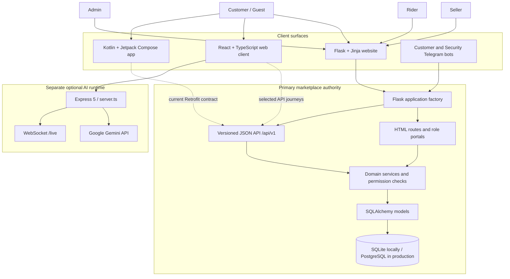
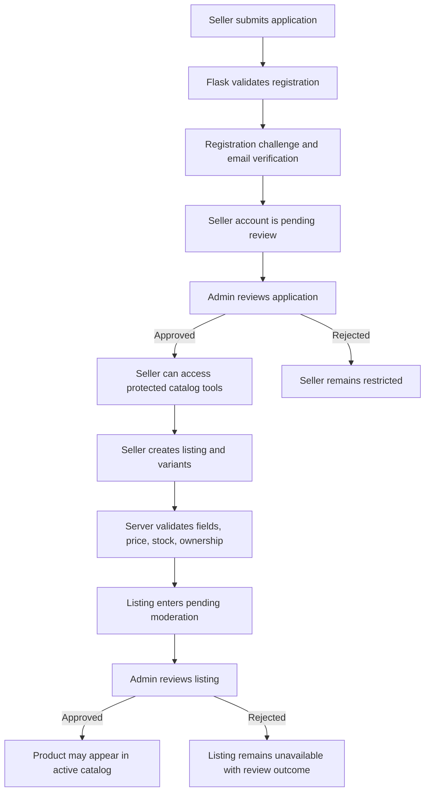
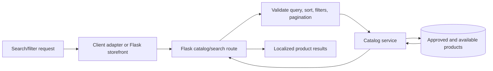
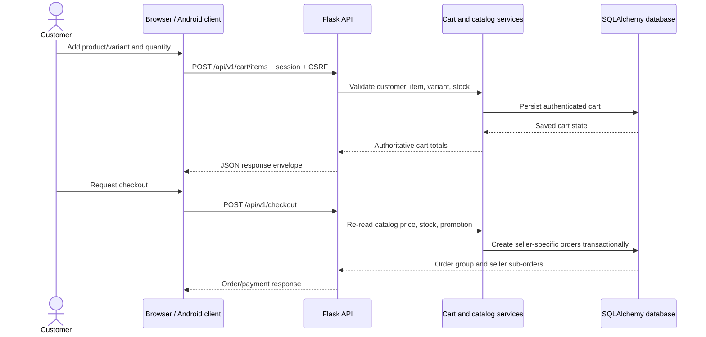
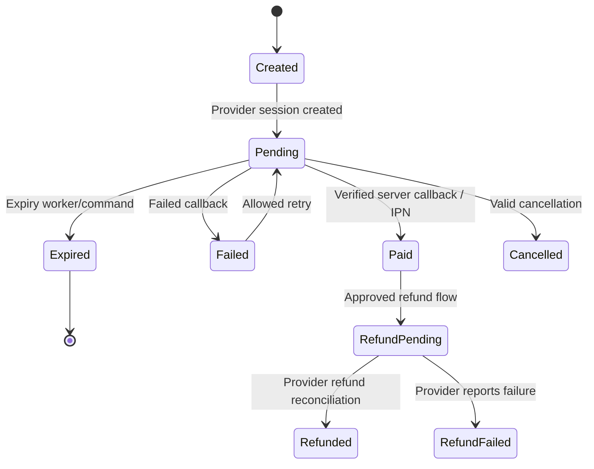
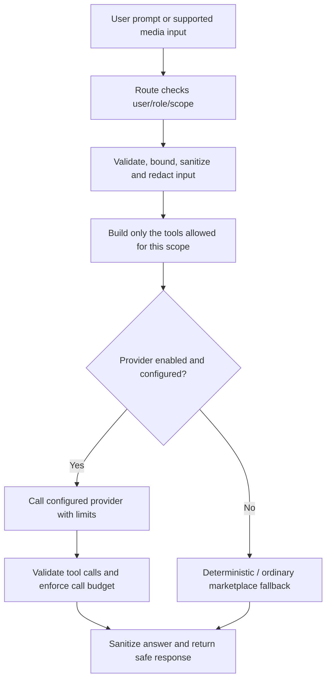
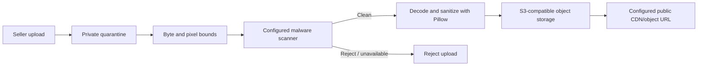

<div align="center">
  
  <h1>NexHaat</h1>
  <p><strong>A Bangladesh-first, multilingual, multi-vendor commerce platform.</strong></p>
  <p>One marketplace foundation for customers, independent sellers, delivery riders, and marketplace operations.</p>
  <p>
    <a href="https://github.com/shajeduzzamanenan992008inc/NexHaat/actions/workflows/ci.yml">
      
    </a>
    
    
    
    
    
  </p>
  <p><em>Repository documentation snapshot: <code>main</code> at <code>e1b8449</code> · 1 November 2026</em></p>
</div>

---

> [!IMPORTANT]
> **Read the implementation status before relying on a feature.** NexHaat contains a substantial Flask marketplace, a React client, a Kotlin/Jetpack Compose Android client, and an additional Express/Gemini service. These surfaces are not all integrated to the same depth. The Flask application is the authoritative marketplace backend. Some React portals retain demo/local state, some React journeys are only partially connected, and the Android client currently covers a narrower API contract. A source file or screen is not proof of a completed end-to-end production journey.

## Table of contents

- [1. Project at a glance](#1-project-at-a-glance)
- [2. Project goals and product principles](#2-project-goals-and-product-principles)
- [3. Product and user roles](#3-product-and-user-roles)
- [4. Visual identity and website imagery](#4-visual-identity-and-website-imagery)
- [5. System architecture](#5-system-architecture)
- [6. Runtime and trust boundaries](#6-runtime-and-trust-boundaries)
- [7. End-to-end business workflows](#7-end-to-end-business-workflows)
- [8. Feature inventory](#8-feature-inventory)
- [9. Integration and completion matrix](#9-integration-and-completion-matrix)
- [10. Technology stack](#10-technology-stack)
- [11. Repository structure](#11-repository-structure)
- [12. Local development prerequisites](#12-local-development-prerequisites)
- [13. Run the Flask marketplace](#13-run-the-flask-marketplace)
- [14. Run the React and Express application](#14-run-the-react-and-express-application)
- [15. Build and run the Android application](#15-build-and-run-the-android-application)
- [16. Configuration reference](#16-configuration-reference)
- [17. Database model and migration workflow](#17-database-model-and-migration-workflow)
- [18. REST API conventions](#18-rest-api-conventions)
- [19. Authentication, authorization, and sessions](#19-authentication-authorization-and-sessions)
- [20. AI architecture and provider configuration](#20-ai-architecture-and-provider-configuration)
- [21. Telegram integrations](#21-telegram-integrations)
- [22. Email, payments, media, and external services](#22-email-payments-media-and-external-services)
- [23. Internationalization and localization](#23-internationalization-and-localization)
- [24. Testing and quality engineering](#24-testing-and-quality-engineering)
- [25. Continuous integration and repository automation](#25-continuous-integration-and-repository-automation)
- [26. Production deployment](#26-production-deployment)
- [27. Operations, observability, backup, and recovery](#27-operations-observability-backup-and-recovery)
- [28. Security and privacy engineering](#28-security-and-privacy-engineering)
- [29. Troubleshooting](#29-troubleshooting)
- [30. Roadmap and release readiness](#30-roadmap-and-release-readiness)
- [31. Contributing](#31-contributing)
- [32. Documentation and ownership](#32-documentation-and-ownership)
- [33. Licensing and reuse](#33-licensing-and-reuse)
- [34. Glossary](#34-glossary)

---

# 1. Project at a glance

**NexHaat** is a Bangladesh-first marketplace codebase designed for multi-vendor commerce. Its primary application supports customer shopping, seller-owned catalog operations, delivery workflows, and administrative oversight. The project also contains client applications and optional AI integrations that communicate across defined boundaries.

| Attribute | Current repository evidence |
|---|---|
| Repository | `shajeduzzamanenan992008inc/NexHaat` |
| Default branch | `main` |
| Repository visibility | Private |
| Primary backend | Python / Flask application factory |
| Server-rendered interface | Flask + Jinja templates |
| Versioned API | Flask JSON API under `/api/v1` |
| Additional web client | React 18 + TypeScript + Vite |
| Additional AI/API runtime | Node.js + Express 5 + Google GenAI SDK |
| Android client | Kotlin + Jetpack Compose + Retrofit + Hilt |
| Local database | SQLite |
| Intended production database | PostgreSQL with encrypted connections |
| Main transactional email integration | Brevo |
| Online payment integration | SSLCOMMERZ hosted checkout |
| Product image pipeline | Private quarantine, malware scan, image sanitization, S3-compatible storage |
| Localization | English, Bangla, Hindi, Arabic in the Flask application |
| Python tests | pytest |
| Node tests | Node.js built-in test runner |
| Python lint | Ruff |
| Web checks | TypeScript, Vite production build |
| Android build system | Gradle wrapper |

## What NexHaat is—and is not

NexHaat is a modular marketplace application with several client surfaces. It is **not** currently a set of independently scaled microservices, and its repository should not be described as a production-proven Amazon-scale platform. Its architecture and roadmap intentionally favor preserving the existing modular Flask foundation until measured operational requirements justify a separate migration.

The root `README.md` is an engineering and onboarding guide. It does not replace the canonical roadmap, security documentation, API source, migrations, or production runbooks linked later in this document.

## Project links

- **Source repository:** [NexHaat on GitHub](https://github.com/shajeduzzamanenan992008inc/NexHaat) — private repository; access requires permission.
- **License notice:** [`LICENSE`](LICENSE) — proprietary draft notice; read its restrictions before reuse.
- **Canonical roadmap:** [`docs/plans/nexhaat-master-plan.md`](docs/plans/nexhaat-master-plan.md)
- **Engineering agent rules:** [`AGENTS.md`](AGENTS.md)
- **Copilot instructions:** [`.github/copilot-instructions.md`](.github/copilot-instructions.md)
- **Live website:** no public production URL was verified for this documentation snapshot. Do not treat a historical or unverified hosting address as a working demo.

---

# 2. Project goals and product principles

## Product direction

The product direction is to connect local and regional sellers with customers through one discoverable marketplace, supported by role-specific operational workflows. Bangladesh is the initial product context: BDT transactions, local payment and messaging providers, Bangla/Banglish discovery improvements, and multilingual interfaces.

The longer-term product vision includes broader retail categories, stronger seller tooling, improved discovery, trustworthy promotions, delivery operations, customer support, scoped AI assistance, Android access, and later international expansion. Items in that vision are targets—not automatically implemented features.

## Engineering principles

1. **Preserve working behavior.** Extend existing services, route groups, API contracts, migrations, and design components instead of replacing the platform without a reviewed architecture proposal.
2. **Keep marketplace authority on the server.** Prices, discounts, inventory, order state, user identity, payment state, seller ownership, and role authorization must be decided by Flask/database services—not trusted from a browser or mobile client.
3. **Use a modular monolith until evidence says otherwise.** Split services only when measured scale, independent release needs, team ownership, or fault-isolation justify the operational cost.
4. **Make financial operations auditable.** Use decimal arithmetic, server-side validation, transaction boundaries, immutable order snapshots where appropriate, idempotent callbacks, and reconciliation records.
5. **Fail closed on sensitive operations.** Missing credentials, unscanned product media, invalid roles, failed payment validation, and unverified external callbacks must not silently become successful actions.
6. **Design for graceful degradation.** Optional AI should not prevent ordinary catalog, cart, order, or support functions from working.
7. **Protect user data.** Minimize collection, avoid sensitive request logging, scope every private query by the authenticated owner, and document retention choices.
8. **Measure before optimizing.** Add caches, queues, search infrastructure, service extraction, or autoscaling only after profiling actual bottlenecks.
9. **Accessibility and localization are product requirements.** Preserve responsive layouts, keyboard support, reduced-motion behavior, locale-aware content, and RTL direction where implemented.
10. **Evidence over marketing.** State what code exists, what local tests cover, and what still requires staging, provider, device, or operator verification.

---

# 3. Product and user roles

NexHaat uses role-specific workflows. The Flask session and server-side permission checks are authoritative for the primary marketplace.

| Role | Responsibilities | Main Flask areas |
|---|---|---|
| Guest | Browse public catalog, search, choose a language, and use guest cart behavior where allowed | Storefront, catalog, signed session |
| Customer | Maintain account, cart, wishlist, checkout, orders, returns, notifications, and support | `/auth`, `/account`, `/cart`, `/orders`, `/customer`, `/support` |
| Seller | Apply for marketplace access, manage seller-owned listings and variants, track seller orders, and view settlement information | `/seller/*` |
| Rider | Maintain rider profile/availability and update only assigned deliveries | `/rider/*` |
| Admin | Review seller applications and listings, oversee orders and users, moderate reports, configure marketplace operations, and inspect audit events | `/admin/*` and protected admin API |
| Super Admin / primary Admin | Higher-trust platform administration as defined by existing route policy and primary-admin rules | Protected Admin routes and account operations |
| Support | Support-related role/policy where explicitly enabled in the application | Existing support route/service boundaries |

### Role safety rules

- A seller must not access another seller's products, orders, or settlement records.
- A customer must not access another customer's cart, order, address, or private account data.
- A rider may update only a delivery assigned to that rider, unless an Admin action is explicitly authorized.
- Admin-only operations must be checked on the server for every request; hiding a button in a client is not authorization.
- Pending seller accounts do not receive approved-seller catalog privileges.
- The React demo role selector and sample data are not an authentication boundary.

---

# 4. Visual identity and website imagery

## Brand asset

The repository contains the NexHaat SVG brand mark at [`public/logo.svg`](public/logo.svg). The mark is included at the top of this README so the project page uses the repository's actual brand asset rather than an invented logo.

The Flask server-rendered interface also references `app/static/logo.svg` and its own static stylesheet and templates. Keep the two client surfaces visually consistent when changing the brand; do not assume that updating one logo updates every runtime.

## Website screenshots

No verified browser screenshots of the current live website were located in the repository files inspected for this README. Therefore, this document does **not** present generated concept art as a real product screenshot.

When genuine screenshots are captured from a running, approved development or staging environment, add them under a stable path such as `docs/assets/screenshots/` and document:

- which client they show (Flask/Jinja, React, or Android);
- the route/screen and viewport/device size;
- whether the data is synthetic/demo data or a staging dataset;
- the commit or release that produced the screenshot;
- any test-account or private information that must be blurred before publication.

Suggested gallery plan:

| Screenshot | Suggested capture | Status in inspected repository |
|---|---|---|
| Storefront | Desktop home page, light theme | Not verified/available in this snapshot |
| Storefront | Mobile viewport and responsive navigation | Not verified/available in this snapshot |
| Product detail | Product, variants, stock, and purchase actions | Not verified/available in this snapshot |
| Customer | Cart and order history | Not verified/available in this snapshot |
| Seller | Flask seller catalog and product moderation state | Not verified/available in this snapshot |
| Rider | Assigned delivery workflow | Not verified/available in this snapshot |
| Admin | Moderation and operations dashboard | Not verified/available in this snapshot |
| Android | Compose home, catalog, search, and cart | Not verified/available in this snapshot |

Do not put real customer names, phone numbers, addresses, OTPs, payment references, access tokens, or private production records into screenshots.

---

# 5. System architecture

NexHaat currently has four notable application surfaces: the primary Flask site/API, a React client, an Android client, and a separate Express/Gemini service. They have different integration levels and trust boundaries.

## High-level system map



The diagram shows logical relationships, not a claim that every feature is wired through every client. In particular, React Seller/Admin screens and some customer journeys retain local/demo state or lack a verified adapter. The integration matrix in [Section 9](#9-integration-and-completion-matrix) is the more precise source for client coverage.

## 5.1 Primary Flask application

The Flask application is the source of truth for the marketplace backend.

- `run.py` imports `create_app()` and exposes the WSGI `app` object used by the root `Procfile`.
- `app/__init__.py` creates the Flask application, initializes extensions, registers routes and blueprints, configures shared request/response behavior, and attaches CLI operations.
- `app/routes/` contains server-rendered HTML routes for the storefront, authentication, seller, customer, rider, Admin, orders, support, notifications, wishlist, and AI interfaces.
- `app/api/` registers the versioned JSON API at `/api/v1` and its route groups.
- `app/services/` holds marketplace business operations such as checkout, catalog, payments, email, audit, backup, notifications, and media handling.
- `app/models.py` and related model definitions represent persistent entities and relationships.
- `migrations/` contains Alembic revisions managed through Flask-Migrate.
- `app/templates/` and `app/static/` contain the Flask/Jinja presentation layer and static resources.

The Flask `Procfile` starts Gunicorn with two workers, four threads per worker, and a 120-second timeout. This configuration is a repository default, not a load-tested capacity recommendation.

## 5.2 React and Vite client

The additional browser client is built with React 18 and TypeScript.

- `src/App.tsx` composes shared navigation, cart, toast, AI drawer, comparison UI, Prime modal, lazy-loaded pages, and the footer.
- `src/context/AppContext.tsx` manages application view state, product/category state, user-facing interactions, Firebase auth state, Flask auth state, and selected Flask API calls.
- `src/pages/` contains customer-facing pages and role portal screens.
- `src/components/` contains reusable interaction and layout components.
- `src/lib/flaskAuth.ts` handles Flask session authentication and CSRF for the React adapter.
- `src/lib/marketplaceApi.ts` contains typed adapters for a subset of marketplace operations.
- `src/data/mockData.ts` provides initial/demo data. Some screens retain local/demo fallbacks and must not be mistaken for authoritative live data.
- `vite.config.ts` configures the development client build.

The root `server.ts` is an Express application that mounts Vite middleware in development and serves the built `dist/` client in production. It is therefore both the Node API boundary and the production static frontend server for this additional client.

## 5.3 Android client

The Android module is a Kotlin application using Jetpack Compose, Navigation Compose, Hilt, Retrofit, OkHttp, Kotlin serialization, Coil, Paging, and DataStore.

- `android/app/src/main/java/com/nexhaat/app/MainActivity.kt` initializes the Compose UI and theme.
- `ui/navigation/NavGraph.kt` declares the current navigation graph for home, categories, products, search, product detail, cart, and sign-in.
- `data/remote/ApiService.kt` defines the current Retrofit endpoint contract.
- `di/NetworkModule.kt` constructs Retrofit, OkHttp, cookie, and CSRF dependencies.
- `BuildConfig.BASE_URL` is generated from build-time configuration.
- Debug and release API/media base URLs are distinct. The default release API URL is a placeholder and must be replaced before a release build can be considered deployable.

The current Android source is a client foundation with selected catalog, search, session, and cart endpoints. Do not claim full mobile feature parity with the Flask application.

## 5.4 Express and Gemini service

The root `server.ts` hosts optional Gemini-backed capabilities. It uses the `@google/genai` SDK, Express, Node's HTTP server, and `ws` for the `/live` audio WebSocket.

The service contains route families for Gemini chat, search/maps grounding, audio transcription, image generation/editing, video generation/animation, music generation, PubChem lookup, food/product science analysis, and real-time audio interaction. The service expects its provider credential in the server environment as `GEMINI_API_KEY`.

This service is distinct from the Flask AI Core. It must not be treated as a second marketplace identity or authorization system. CORS/origin validation is not a replacement for authentication. Do not expose customer-specific operations through Express until a reviewed identity bridge and explicit authorization contract exist.

---

# 6. Runtime and trust boundaries

Keeping these boundaries clear is essential for safe future development.

| Boundary | Responsibility | Must not become |
|---|---|---|
| Flask routes and API | Authenticate session, validate input, authorize role/ownership, call domain services | A thin pass-through that trusts client-supplied prices or roles |
| Flask domain services | Apply catalog, cart, checkout, payment, return, delivery, notification, and audit rules | A place to bypass route-level authorization or database transaction rules |
| SQLAlchemy/database | Persist marketplace state and enforce relationships/constraints | A client-readable store with unchecked cross-user access |
| React browser state | Render UI, manage ephemeral state, call approved adapters | An authority for price, payment, stock, seller identity, or Admin permission |
| Firebase client integration | Existing Google sign-in / Firebase client capabilities where used | An assumed identity bridge into Flask without verified token exchange |
| Android Retrofit client | Call the existing versioned Flask API contract | An independent owner of commerce rules |
| Flask AI Core | Optional role-scoped AI orchestration and approved marketplace tools | An unrestricted agent with access to all user or Admin data |
| Express/Gemini | Optional provider-oriented AI and science/media endpoints | A trusted authenticated marketplace backend based on browser origin alone |
| Telegram webhooks | Separate customer and read-only security bot entry points | A shell, database-console, or arbitrary Admin command interface |

## 6.1 Flask is the commerce authority

The authoritative values for a transaction are read or calculated on the server. The client may submit product identifiers, variant identifiers, quantities, address choices, or a promotion code; it must not determine the final unit price, discount share, delivery charge, payment success, seller ownership, or available stock.

## 6.2 Firebase and Flask identity are separate capabilities

The React context imports Firebase Authentication/Firestore and also contains a Flask authentication adapter. The repository does not establish a verified Firebase-to-Flask token exchange or a single unified identity bridge. Keep these concepts separate unless a reviewed design introduces a secure link or migration path.

## 6.3 Local/demo data is not production truth

The React context initializes with mock data and can preserve local state if a catalog fetch returns an error or no items. A successful page render is therefore not proof of live backend hydration. Use the Flask API/database and verified authenticated sessions when checking production behavior.

## 6.4 Separate deployment targets

The root `Procfile` starts Flask/Gunicorn. It does not build, deploy, or supervise the Node/Express runtime or the Android application. Each runtime needs its own build, secret configuration, health checks, release process, and rollback decision.

---

# 7. End-to-end business workflows

This section explains the intended server-side journeys using the current route/service boundaries. It distinguishes established code paths from client integration gaps.

## 7.1 Seller onboarding and product publishing



1. A user submits a customer or seller registration request through the applicable Flask registration flow.
2. Registration challenges are session-bound and use an expiring, one-time code. The documented controls include a ten-minute expiry, sixty-second resend interval, and five failed attempts.
3. A seller application remains restricted until an Admin approves the seller profile.
4. An approved seller creates or edits a listing through the Flask seller routes. The server validates category, name, description, source language, price, stock, and variant details.
5. A new or edited listing returns to a pending moderation state and is not publicly available until the required Admin review succeeds.
6. Seller queries and updates must be constrained to the current seller's records.
7. The product image pipeline is a separate fail-closed operation described in [Section 22](#22-email-payments-media-and-external-services).

**Client boundary:** the Flask seller catalog workflow exists. The inspected React Seller Portal still contains demo/local management behavior and is not a verified replacement for the Flask seller tools.

## 7.2 Product discovery and catalog search



- Public product queries must include only active/approved/available catalog records according to the catalog service policy.
- Search and filtering support catalog parameters such as query, category, price, stock, seller, rating, promotion, sorting, and pagination where implemented by the relevant route.
- The roadmap records weighted Bangla/Banglish search relevance, minimum-rating and on-sale facets, accessible suggestions, zero-result recovery, and discovery indexes as implemented slices.
- A client that caches or seeds product data must refresh from the authority and must not use stale display values for checkout.
- Product detail and review APIs exist in Flask; the inspected React product-detail/review journey is not fully wired to those APIs.

## 7.3 Customer cart and checkout



1. A guest may hold an ephemeral cart in the signed session. An authenticated customer has a database-backed cart.
2. When a guest signs in, the existing cart merge path reconciles items with current product and variant availability.
3. Cart mutations validate that the product is active and available, that any selected variant belongs to the product and is active, and that stock is positive.
4. The server reads the current item price and available stock. The UI's displayed price is informational only.
5. Checkout groups cart lines by seller and creates seller-specific sub-orders within one checkout group.
6. The service computes subtotals, delivery charges, promotion eligibility and discount allocations on the server using decimal arithmetic.
7. A checkout must reject empty, unavailable, or invalid carts and must not accept client-calculated totals as authoritative.
8. The current React checkout adapter submits cash on delivery (COD); the React client does not yet complete the online SSLCOMMERZ continuation.

## 7.4 Online payment lifecycle



- The Flask payment service supports COD and configured SSLCOMMERZ hosted checkout.
- Online attempts are persisted with provider/session status and an expiry policy.
- A browser return URL is not proof of payment. Payment success must be based on server-side provider validation/callback handling.
- Duplicate, forged, amount-mismatched, or out-of-order callbacks must be handled by validation and idempotent state transitions.
- Expired unpaid sessions can release reserved stock through the existing expiry operation.
- Seller-specific order/payment/settlement snapshots support later reconciliation.
- The payment service includes refund and settlement paths; real merchant credentials and provider callback verification remain deployment gates.
- Do not run live payment tests against real customer accounts or production money without the approved provider sandbox/process.

## 7.5 Delivery and proof of delivery

1. An Admin assigns an active Rider to an order.
2. The delivery state is separate from the order state and uses validated transitions: `unassigned → assigned → picked_up → out_for_delivery → delivered`, with a `failed` branch.
3. The assigned Rider can advance only the delivery records assigned to that Rider. Admin intervention is controlled by the relevant Admin policy.
4. Marking a delivery as delivered requires proof: an allowed uploaded image or a written note.
5. Delivery timestamps and the resulting order status are recorded.
6. A successful delivery can make the seller ledger eligible according to the settlement and return-window rules.
7. The current release does not claim live GPS tracking.

## 7.6 Returns, refunds, and seller settlement

- A customer return/cancellation request is checked against the authenticated customer's order ownership and current order state.
- Return review and refund decisions are handled through Flask order/payment services.
- Provider refunds and manual return adjustments must be auditable and reconciled.
- Seller earnings, commissions, and payout eligibility are calculated and recorded on the server.
- Commission configuration and historical snapshots must not be silently recalculated when a global setting changes.
- A seller must only see their own orders, returns, balance, and payout history.

## 7.7 Transactional email

1. A marketplace event requests a transactional email.
2. The message is rendered and placed in the persistent outbound email outbox.
3. Delivery is attempted through the configured mail provider.
4. Failed deliveries retain retry state; `retry-emails` can retry pending records.
5. Provider secrets must never appear in application logs or diagnostic output.

A durable outbox is not by itself proof of a correctly scheduled background worker. Configure and monitor the deployment scheduler/worker path before relying on retry operations for production delivery.

## 7.8 Telegram customer and security bots

The two bots use different tokens and webhook secrets. The customer bot can search the active catalog and work with a linked customer's shared cart; checkout remains in the authenticated marketplace. The security bot is read-only and limits access to an explicit numeric Telegram user-ID allowlist.

The security bot must not execute shell commands, arbitrary SQL, firewall operations, or general account changes. See [Section 21](#21-telegram-integrations) and the [Telegram operations guide](docs/operations/telegram-bots.md).

## 7.9 AI request lifecycle



- The Flask AI Core applies a scope such as customer, seller, Admin, or Security.
- It sanitizes prompts and redacts personal data before provider use.
- It creates a limited tool registry for the active scope and constrains context, token budget, timeout, and tool-call count.
- Seller-generated listing content is a draft for human review; AI must not publish a listing itself.
- Admin and Security AI tools are read-only.
- When AI is disabled or incomplete, ordinary marketplace functions continue and the assistant should fall back safely.
- The separate Express/Gemini runtime is not the same AI scope system and must not be granted marketplace authority implicitly.

---

# 8. Feature inventory

This inventory describes code areas observed in the repository. It is not a guarantee that every feature is exposed by all clients or enabled in production.

## 8.1 Marketplace foundation

- Customer sign-up and authentication flows.
- Password reset and account settings through Flask.
- Admin email OTP login and staff invitation flows.
- Seller application and Admin approval/rejection.
- Rider account invitation and delivery assignment.
- Customer and seller role guards.
- Shared navigation, locale selection, and account-aware interface elements.

## 8.2 Catalog and merchandising

- Seller-owned product listings.
- Product categories and category management.
- Product variant records and variant-level stock.
- Seller-provided translations for catalog content.
- Admin moderation of product submissions.
- Catalog search, filtering, sorting, and pagination.
- Product review/report workflows in Flask.
- Promotion codes and seller/marketplace campaign records.
- Recently viewed products and deterministic recommendations/cross-sell slices.
- Weighted Bangla/Banglish relevance and zero-result recovery slices.

## 8.3 Commerce and order operations

- Guest and signed-in customer cart handling.
- Authenticated customer cart persistence.
- Multi-seller checkout and seller-specific order records.
- COD checkout and SSLCOMMERZ hosted-payment support in Flask.
- Payment attempts, expiry, callback/IPN validation, and reconciliation services.
- Seller-specific invoice PDF generation.
- Customer order history, cancellation, return, and refund routes in Flask/API.
- Seller order workflows and seller settlement records.
- Rider assignment, delivery-state validation, and proof of delivery.

## 8.4 Notifications and support

- In-app notification records and read state.
- Transactional email outbox and retry commands.
- Customer support routes/cases in Flask.
- Opt-in deterministic cart reminders/recommendation digests.
- Telegram customer and security notification routes.

## 8.5 AI and provider integrations

- Shared, optional Flask AI Core with OpenAI-compatible provider adapter.
- Customer shopping assistant and approved catalog/cart/order tools.
- Seller listing assistance that remains subject to normal seller review.
- Read-only Admin and allowlisted Security AI scopes.
- Capability-dependent visual and voice search.
- Separate Express/Gemini chat and grounding endpoints.
- Separate Express image/audio/video/music provider endpoints.
- PubChem compound lookup and food/product science analysis routes.
- Live Gemini audio interaction via WebSocket.

## 8.6 Administration and reliability

- Seller/customer/Admin account operations.
- Seller and product moderation.
- Review/report moderation.
- Audit events for security- and marketplace-relevant actions.
- Liveness/readiness endpoints.
- Database size monitoring and a configurable ceiling.
- Backup verification and guarded restore CLI.
- Production readiness diagnostic command.

## 8.7 Android client features (Kotlin + Jetpack Compose)

The native Android client under `android/` implements the complete core marketplace surface:
- **Architecture**: Clean MVVM architecture with Kotlin Coroutines, StateFlow, Hilt dependency injection, Navigation Compose, and Retrofit with Kotlinx Serialization.
- **Home & Catalog**: Featured banners carousel, responsive category grid, live search with instant filtering, product detail screen with variant selector and image resolver.
- **Flash Deals & Promotions**: Dedicated Deals screen with countdown badges, promotional highlights, discount prices, and direct add-to-cart affordance.
- **Cart & Complete Checkout**: Persistent server-backed cart with quantity controls, promotion code discount calculation, delivery address input, Cash on Delivery (COD) / SSLCOMMERZ gateway selection, and instant order placement with confirmation receipt.
- **Order History & Lifecycle**: Customer orders list, status badges (pending, confirmed, processing, shipped, delivered, cancelled), cancellation for unfulfilled orders, and return request submission.
- **Wishlist**: Saved items screen with quick Move to Cart and item removal.
- **Notifications**: System and order status notification feed with unread badges and mark-all-read action.
- **Portals & Support Hub**: Multi-tab hub containing Seller Performance metrics (active listings, pending orders, sales), Rider Hub (active shift deliveries), and Customer Support FAQs with helpline contacts.
- **Security & Biometrics**: Jetpack BiometricPrompt session unlock with hardware status verification and secure credential handling.

---

# 9. Integration and completion matrix

The project has an end-to-end connectivity audit dated 1 November 2026 at [`docs/architecture/PHASE33_END_TO_END_INTEGRATION_AUDIT_REPORT.md`](docs/architecture/PHASE33_END_TO_END_INTEGRATION_AUDIT_REPORT.md). Its classifications distinguish source presence, local tests, partial client connections, and unverified live behavior.

| Journey | Flask backend | React client | Android client | Current documentation status |
|---|---|---|---|---|
| Public catalog and search | Implemented | API fetch exists; mock fallback remains | Retrofit endpoints + Jetpack Compose UI | Fully connected |
| Registration / OTP | Implemented in Flask | Registration adapter exists | Retrofit Auth integration | Preserves Flask cookie/session contract |
| Login / session | Implemented | Flask adapter and Firebase capability both exist | Session login endpoint, cookie/CSRF, BiometricPrompt | Session verified |
| Product detail / reviews | Flask detail/review endpoints exist | Product UI uses context | Product detail, variant selection, price resolution | Fully connected |
| Cart / wishlist | Flask endpoints and server rules exist | Cart/wishlist adapters exist | Complete Cart & Wishlist screens + repositories | Fully connected |
| COD checkout | Flask endpoint/service exists | COD adapter exists | Complete Checkout screen with delivery info & COD | Fully connected |
| SSLCOMMERZ continuation | Flask flow exists | React adapter currently uses COD only | Gateway selection & order creation in CheckoutScreen | Fully connected |
| Customer order history | Flask/API exists | Adapter exists | Dedicated OrdersScreen with live order list | Fully connected |
| Cancellation / returns | Flask/API exists | Some adapters exist | Direct cancel and return dialog in OrdersScreen | Fully connected |
| Deals & Promotions | Flask promotion rules exist | Deals page exists | DealsScreen with promo banners & discounted catalog | Fully connected |
| Notifications | Flask notification routes exist | Notifications page exists | NotificationsScreen with unread badges & mark-all-read | Fully connected |
| Seller / Rider / Support | Flask seller/support routes exist | Portal pages exist | PortalsScreen with Seller Hub, Rider Hub, and Support FAQs | Fully connected |
| Telegram | Two Flask bot integrations | N/A | N/A | Webhook setup remains an operator gate |
| Media upload | Flask quarantine/scan/store service | React upload not connected to this pipeline | Image URL resolver exists | Scanner, bucket, and browser/device delivery need live checks |

## Status vocabulary

- **SOURCE_VERIFIED:** current source defines a traceable integration contract; runtime success is not implied.
- **LOCAL_TEST_VERIFIED:** the relevant local automated tests have passed; staging/live behavior is still separate.
- **PARTIALLY_CONNECTED:** part of the journey is wired, but the UI still has local/mock state or a required continuation is missing.
- **BACKEND_ONLY:** Flask server-rendered/API behavior exists, but the inspected client does not provide a verified connection for the journey.
- **BLOCKED_BY_CONFIGURATION:** code exists but a provider, credential, deployment, or operator prerequisite is missing.
- **LIVE_VERIFICATION_REQUIRED:** source and local checks are insufficient to prove the real deployed browser/device/provider workflow.
- **NOT_TESTED:** no applicable check was run in the stated audit window.

Do not silently upgrade a status because a button, endpoint, page, route, or DTO exists. Update the matrix only with current evidence and a focused acceptance test.

---

# 10. Technology stack

| Layer | Technologies observed |
|---|---|
| Primary backend | Python `>=3.11,<4.0`, Flask 3.x |
| Authentication / sessions | Flask-Login, Flask-WTF, itsdangerous, application security helpers |
| ORM / database | Flask-SQLAlchemy, SQLAlchemy, SQLite, PostgreSQL via psycopg |
| Schema migrations | Flask-Migrate and Alembic |
| Localization | Flask-Babel and gettext catalogs |
| Server-rendered frontend | Jinja templates, HTML, CSS, browser JavaScript |
| Browser client | React 18, TypeScript, Vite 6, Tailwind CSS 3 |
| Node runtime | Node.js 22 in CI; Express 5, `tsx` |
| Gemini integration | `@google/genai` |
| WebSocket | `ws` |
| Firebase client | Firebase Web SDK, Auth and Firestore imports |
| Android | Kotlin, Jetpack Compose, AndroidX Navigation, Hilt |
| Android networking | Retrofit, OkHttp, Kotlin serialization |
| Android media/data | Coil Compose, Paging, DataStore |
| Image handling | Pillow |
| Product media scanning | ClamAV-compatible command configured by the operator |
| Object storage | S3-compatible provider through AWS SDK/boto3 |
| PDF invoice generation | ReportLab |
| Email provider | Brevo API integration |
| Payment gateway | SSLCOMMERZ hosted checkout |
| Python test | pytest |
| Python lint | Ruff |
| Node test | `node:test` |
| Android unit test | JUnit 4 (and AndroidX test dependencies) |
| CI | GitHub Actions |

## Runtime versions

- Python package metadata declares `>=3.11,<4.0`.
- The current CI workflow tests Python 3.11, 3.12, 3.13, and 3.14.
- The Node CI workflow uses Node.js 22.
- Android uses Java 17 bytecode configuration, Kotlin 2.2.20, Android Gradle Plugin 8.9.1, compile/target SDK 36, and minimum SDK 24 in the current Gradle files.
- The Android Gradle wrapper configuration points to Gradle 9.7.1. Use the checked-in wrapper rather than an arbitrary globally installed Gradle version.

These are repository configuration facts. Confirm toolchain compatibility against the current Android Studio/SDK installation before changing versions.

---

# 11. Repository structure

The following is a conceptual map of important directories and files. It is intentionally not an exhaustive list of every generated asset or migration.

```text
NexHaat/
├── app/
│   ├── __init__.py                 # Flask application factory and CLI registration
│   ├── config.py                   # Environment-aware application configuration
│   ├── extensions.py               # Shared Flask extensions
│   ├── models.py                   # Marketplace data models
│   ├── api/                        # Versioned JSON API and serializers
│   ├── ai/                         # Scoped Flask AI core, tools, prompts, guardrails
│   ├── routes/                     # Flask HTML route groups
│   ├── services/                   # Domain services and integrations
│   ├── telegram/                   # Customer and Security Telegram webhooks
│   ├── templates/                  # Jinja pages and email templates
│   ├── static/                     # CSS, JS, logo, and local static resources
│   └── translations/               # gettext .po/.mo locale catalogs
├── android/
│   ├── app/
│   │   ├── src/main/java/com/nexhaat/app/
│   │   │   ├── data/               # DTOs, repositories, remote API, local data
│   │   │   ├── di/                 # Hilt dependency injection
│   │   │   ├── ui/                 # Compose screens, navigation, theme
│   │   │   └── MainActivity.kt
│   │   └── build.gradle.kts
│   ├── gradle/wrapper/             # Pinned Gradle wrapper distribution
│   ├── gradlew
│   └── gradlew.bat
├── docs/
│   ├── architecture/               # Dated architecture and integration reports
│   ├── operations/                 # Deployment and provider runbooks
│   └── plans/                      # Canonical product/engineering roadmap
├── migrations/                     # Flask-Migrate/Alembic schema revisions
├── scripts/                        # Repository validation and helper scripts
├── src/
│   ├── components/                 # React components
│   ├── context/                    # React application state/context
│   ├── data/                       # Demo/initial client data
│   ├── lib/                        # Firebase, Flask auth, API adapters
│   ├── pages/                      # React page components
│   ├── types/                      # Shared TypeScript domain types
│   └── main.tsx
├── tests/                           # Python pytest suite
├── tests-node/                      # Node server/security test suite
├── .github/
│   ├── workflows/                  # CI, security, SBOM/provenance workflows
│   └── copilot-instructions.md     # Repository-level Copilot instructions
├── .env.example                     # Development environment template
├── package.json                     # Node scripts and dependencies
├── package-lock.json                # Locked Node dependency graph
├── pyproject.toml                   # Python version, pytest, Ruff configuration
├── requirements.txt                 # Python runtime dependency ranges
├── requirements-dev.txt             # Runtime dependencies plus pytest for development/CI
├── Procfile                         # Flask/Gunicorn process entrypoint
├── run.py                           # Flask CLI/WSGI app factory entrypoint
├── server.ts                        # Express + Vite + Gemini server
├── serverSecurity.ts                # Express CORS, validation, limits, safe errors
├── index.html                       # Vite document entrypoint
├── vite.config.ts                   # Vite configuration
├── tsconfig.json                    # TypeScript compiler configuration
├── public/logo.svg                  # React/Vite NexHaat brand mark
├── AGENTS.md                        # Engineering-agent rules
└── README.md                        # This document
```

### Where a change belongs

| Change | Preferred location |
|---|---|
| Flask HTML route or page behavior | `app/routes/` and `app/templates/` |
| JSON API endpoint | `app/api/routes/`, serializers, and shared API response helpers |
| Marketplace business rule | `app/services/` |
| Persistent schema | `app/models.py` plus a new additive migration in `migrations/` |
| Flask AI tool/permission | `app/ai/` and the relevant route/tool registry tests |
| React screen | `src/pages/` |
| Reusable React UI | `src/components/` |
| React API adapter | `src/lib/` |
| Android UI | `android/app/src/main/java/com/nexhaat/app/ui/` |
| Android API/DTO/repository | `android/app/src/main/java/com/nexhaat/app/data/` |
| Android dependency binding | `android/app/src/main/java/com/nexhaat/app/di/` |
| Express/Gemini boundary | `server.ts` and `serverSecurity.ts` |
| Integration/deployment guide | `docs/operations/` |
| Architectural decision or audit | `docs/architecture/` |
| Stage scope/status/acceptance | `docs/plans/nexhaat-master-plan.md` |

---

# 12. Local development prerequisites

## Required tools

| Tool | Required for | Notes |
|---|---|---|
| Git | All development | Clone the private repository using an authorized account |
| Python 3.11+ | Flask backend and tests | Use a virtual environment |
| pip | Python dependency installation | Upgrade inside the virtual environment if needed |
| Node.js 22 | React/Express runtime and build | Matches the current Node CI configuration |
| npm | Node dependency installation | Use `npm ci` to honor the lockfile |
| JDK 17 | Android development | Configure `JAVA_HOME` for Android Gradle |
| Android SDK / Android Studio | Android build and emulator | Current Gradle uses compile/target SDK 36 |
| PostgreSQL (optional locally) | Database integration testing | SQLite is the default local database |
| ClamAV and S3-compatible bucket (optional) | Live product-media publishing | Not required for ordinary local startup; media pipeline fails closed until configured |
| Brevo/SSLCOMMERZ credentials (optional) | Live email/payment integration | Use authorized test/sandbox settings only |
| Gemini API key (optional) | Express Gemini runtime | Keep key server-side; not required for Python-only work |

## Recommended editor setup

Use an editor with Python, TypeScript, Kotlin, YAML, and Markdown support. The repository's `.editorconfig` and `.gitattributes` define shared formatting/line-ending conventions. Keep generated output, local secrets, database files, APKs, and IDE state out of commits unless the repository explicitly tracks the relevant artifact.

## Clone the private repository

```bash
git clone https://github.com/shajeduzzamanenan992008inc/NexHaat.git
cd NexHaat
git switch main
```

If GitHub authentication or repository permission is missing, ask the repository owner to grant access. Do not place a personal access token directly into the clone URL or shell history.

---

# 13. Run the Flask marketplace

The commands below assume a local development environment and a local SQLite database. They do not configure a production deployment.

## 13.1 Create a Python virtual environment

### Windows PowerShell

```powershell
py -3.12 -m venv .venv
.\.venv\Scripts\Activate.ps1
python -m pip install --upgrade pip
python -m pip install -r requirements-dev.txt
Copy-Item .env.example .env
```

If script execution is restricted by the current PowerShell policy, activate the environment using the policy approved for your machine or invoke the environment interpreter directly:

```powershell
.\.venv\Scripts\python.exe -m pip install -r requirements-dev.txt
```

### macOS / Linux

```bash
python3 -m venv .venv
source .venv/bin/activate
python -m pip install --upgrade pip
python -m pip install -r requirements-dev.txt
cp .env.example .env
```

## 13.2 Configure the development environment

Open `.env` and check the local settings. The checked-in template uses a development environment, SQLite, and empty optional integration credentials. It is a dotenv-style file, not a production secret bundle.

Generate a new local Flask signing secret:

```bash
python -c "import secrets; print(secrets.token_urlsafe(48))"
```

Set the generated value as `SECRET_KEY` in the private local `.env` file. Do not copy a production secret into a developer workstation and never commit `.env`.

The local database default is:

```dotenv
DATABASE_URL=sqlite:///instance/food_ordering.sqlite3
```

The application resolves this relative SQLite path against the repository base directory and creates the instance directory when the app initializes.

## 13.3 Apply the database migrations

```bash
python -m flask --app run.py db upgrade
```

Check the current migration head:

```bash
python -m flask --app run.py db heads
python -m flask --app run.py db current
```

Do not replace migrations with manual production SQL or `db.create_all()` shortcuts. Back up an existing database before applying schema changes outside a disposable local environment.

## 13.4 Start the Flask development server

```bash
python -m flask --app run.py run --host 127.0.0.1 --port 5000
```

Open `http://127.0.0.1:5000` in a browser.

The Flask CLI entrypoint uses the application factory in `run.py`. For deployment, the root `Procfile` starts Gunicorn rather than the Flask development server.

## 13.5 Configure the primary Admin account

Set `ADMIN_EMAIL` in the local private environment, ensure the database is the intended development database, then run:

```bash
python -m flask --app run.py ensure-admin
```

The command reconciles the configured primary Admin identity. The implementation is designed to preserve matching account/profile data while adjusting the configured role/session state according to its rules. It is not a general account-reset tool. Never run it against an unintended database.

Admin sign-in uses the email OTP flow. Configure the mail provider before expecting real email delivery. To check Brevo configuration without sending a message:

```bash
python -m flask --app run.py check-mail
```

## 13.6 Useful Flask commands

```bash
python -m flask --app run.py --help
python -m flask --app run.py routes
python -m flask --app run.py db heads
python -m flask --app run.py production-check
```

`production-check` diagnoses configuration readiness. It does not prove that the hosting account, external provider, database, storage bucket, scheduler, or public ingress is healthy.

---

# 14. Run the React and Express application

The root Node project contains the Vite/React client and the Express/Gemini service. They are started together by `server.ts` in development mode.

## 14.1 Install locked dependencies

From the repository root:

```bash
npm ci
```

Use `npm ci` for repeatable installation from `package-lock.json`. Do not replace the lockfile with a broad dependency update as part of an unrelated README or feature change.

## 14.2 Start development mode

```bash
npm run dev
```

The Express server listens on port `3000` and mounts Vite middleware when `NODE_ENV` is not `production`. Open:

```text
http://localhost:3000
```

The React app uses `src/main.tsx` as its browser entry point and `src/App.tsx` as the root composition.

## 14.3 React-to-Flask API origin

`src/lib/flaskAuth.ts` resolves the Flask API origin from `VITE_FLASK_API_ORIGIN`; if unset, it uses the current browser origin. The browser adapters use credentialed requests and obtain/attach CSRF tokens for state-changing requests.

For local same-origin development, prefer a development proxy or a compatible deployment arrangement rather than assuming that Express CORS automatically configures Flask CORS. `EXPRESS_CORS_ORIGINS` applies to the Express service only. If the React site and Flask API are deployed on different origins, review the Flask/edge CORS policy, credentialed cookies, `SameSite` behavior, CSRF origin rules, and allowed headers before exposing the integration.

A browser variable prefixed with `VITE_` is compiled into the client. Never put provider API secrets, database credentials, signing keys, or private tokens in `VITE_*` variables.

## 14.4 Configure optional Gemini functionality

The Express service reads `GEMINI_API_KEY` from its server process environment. Set it only in the local terminal or a private server environment when testing an authorized Gemini integration.

**Windows PowerShell, current terminal only:**

```powershell
$env:GEMINI_API_KEY = "<your-private-key>"
npm run dev
```

**macOS / Linux, current terminal only:**

```bash
export GEMINI_API_KEY='<your-private-key>'
npm run dev
```

Do not paste a real key into source files, README examples, issue reports, screenshots, or logs. The Express service and Flask AI Core use different configuration variables and providers; configuring one does not configure the other.

## 14.5 Node scripts

| Script | Command | Purpose |
|---|---|---|
| `dev` | `npm run dev` | Run `tsx server.ts` with Vite development middleware |
| `build` | `npm run build` | Type-check and create the Vite production build |
| `start` | `npm run start` | Run `server.ts`; set `NODE_ENV=production` to serve `dist/` |
| `lint` | `npm run lint` | Run TypeScript no-emit validation |
| `test` | `npm test` | Run the Node server-security test suite |
| `test:server` | `npm run test:server` | Explicit Node test command |
| `preview` | `npm run preview` | Run Vite's built-client preview server on port 3000 |

The Vite `preview` command is for local build preview. It is not a replacement for deploying the Express service when the production bundle relies on the same-origin `/api/gemini/*` endpoints.

---

# 15. Build and run the Android application

The Android project lives in `android/` and uses the checked-in Gradle wrapper.

## 15.1 Prerequisites

- Android Studio with a compatible Android SDK installation.
- JDK 17 and a valid `JAVA_HOME`.
- Android SDK Platform 36 and the required build tools.
- A running Android emulator or physical Android device for interactive testing.
- A reachable Flask API server for real catalog/session tests.

## 15.2 Configure the debug API origin

The debug build default is `http://10.0.2.2:5000/`, the standard Android Emulator host alias for a development machine's localhost service. Confirm the Flask server is running on port 5000 before testing.

For a physical device, the API URL must point to a reachable development host on the same approved network. Do not use an untrusted public HTTP endpoint. Build configuration reads values from process environment or `android/local.properties`.

Relevant properties:

| Property | Purpose |
|---|---|
| `NEXHAAT_DEBUG_BASE_URL` | Debug API base URL; default emulator bridge is `http://10.0.2.2:5000/` |
| `NEXHAAT_RELEASE_BASE_URL` | Production/staging API base URL for release builds; current default is a placeholder |
| `NEXHAAT_MEDIA_BASE_URL` | Media base used to resolve relative product image paths; release requires an explicit valid value |
| `NEXHAAT_KEYSTORE_PATH` | Local path to the release signing keystore |
| `NEXHAAT_KEYSTORE_STORE_PASSWORD` | Private keystore password |
| `NEXHAAT_KEYSTORE_KEY_ALIAS` | Release signing key alias |
| `NEXHAAT_KEYSTORE_KEY_PASSWORD` | Private signing key password |

Keep `android/local.properties` and keystore files private and out of source control.

## 15.3 Windows PowerShell build and test

```powershell
Set-Location android
.\gradlew.bat :app:assembleDebug
.\gradlew.bat :app:testDebugUnitTest
```

The debug APK is normally generated under:

```text
android/app/build/outputs/apk/debug/
```

## 15.4 macOS / Linux build and test

```bash
cd android
./gradlew :app:assembleDebug
./gradlew :app:testDebugUnitTest
```

## 15.5 Android release safeguards

- The release API base URL is a placeholder until explicitly configured.
- The release media base must be configured; relative product image URLs must not resolve against an untrusted placeholder.
- Release signing credentials are optional in the Gradle script, but without them the release artifact is unsigned and not ready for distribution.
- Use a dedicated signing key with protected backup and access controls. Never commit keystores or passwords.
- Verify the installed app against a staging backend, correct API origin, media origin, authentication cookies, CSRF behavior, image delivery, and error envelope before store submission.
- The current Android API interface does not establish full parity for registration/OTP, orders, returns, seller operations, or Admin operations.

---

# 16. Configuration reference

The authoritative list of supported variables is `.env.example` plus `app/config.py`, the relevant Node code, and `android/app/build.gradle.kts`. This section groups the main settings. A value being present in a template does not mean the corresponding external service is enabled.

## 16.1 Core Flask application

| Variable | Purpose | Guidance |
|---|---|---|
| `APP_ENV` | Environment selection | Use `development` locally and `production` only in a configured host |
| `FLASK_DEBUG` | Flask debugging | Keep disabled outside local development |
| `FLASK_TESTING` | Select testing configuration | Use only for tests |
| `SECRET_KEY` | Session/signing protection | Random, private, sufficiently long; never reuse example value |
| `DATABASE_URL` | SQLAlchemy database URL | SQLite locally; encrypted PostgreSQL in production |
| `PUBLIC_BASE_URL` | Canonical public application origin | Use HTTPS in production; used by links/webhooks |
| `ADMIN_EMAIL` | Primary Admin identity | Configure deliberately and run `ensure-admin` after migrations |
| `SUPPORT_EMAIL` | Optional support contact | Use a valid monitored address |
| `SESSION_COOKIE_SECURE` | Secure-cookie requirement | Enable in HTTPS production |
| `APP_TIMING_ENABLED` | Emit application duration in `Server-Timing` | Enable only when host monitoring consumes it |

## 16.2 Mail and transactional notifications

| Variable | Purpose |
|---|---|
| `BREVO_API_KEY` | Private Brevo API credential |
| `MAIL_DEFAULT_SENDER` | Verified sender address |
| `MAIL_TIMEOUT` | Provider request timeout in seconds |
| `MAX_EMAIL_ATTEMPTS` | Maximum email retry count |

`check-mail` verifies the configured key/sender state without sending an email. It does not verify delivery to a real customer inbox.

## 16.3 Payment settings

| Variable | Purpose |
|---|---|
| `SSLCOMMERZ_STORE_ID` | Merchant/store identifier |
| `SSLCOMMERZ_STORE_PASSWORD` | Private merchant credential |
| `SSLCOMMERZ_SANDBOX` | Select sandbox or live provider mode |
| `SSLCOMMERZ_TIMEOUT` | Provider timeout |
| `PAYMENT_SESSION_MINUTES` | Pending payment session lifetime |

Keep sandbox mode enabled until the approved provider acceptance process is complete. Never test live payment callbacks using production customer orders without explicit operational approval.

## 16.4 Catalog media and uploads

| Variable | Purpose |
|---|---|
| `CATALOG_VIRUS_SCANNER` | Scanner executable; defaults to `clamdscan` |
| `CATALOG_SCAN_TIMEOUT` | Scanner execution limit |
| `CATALOG_QUARANTINE_FOLDER` | Private quarantine directory |
| `CATALOG_MEDIA_BUCKET` | S3-compatible bucket name |
| `CATALOG_MEDIA_REGION` | Storage region |
| `CATALOG_MEDIA_ENDPOINT_URL` | Optional S3-compatible endpoint |
| `CATALOG_MEDIA_PUBLIC_BASE_URL` | Public CDN/object URL origin |
| `CATALOG_MEDIA_KEY_PREFIX` | Object key prefix |
| `MAX_CATALOG_IMAGE_BYTES` | Catalog image byte limit |
| `MAX_CATALOG_IMAGE_PIXELS` | Decoded image pixel limit |
| `MAX_CATALOG_QUARANTINE_BYTES` | Quarantine storage ceiling |
| `CATALOG_QUARANTINE_RETENTION_HOURS` | Quarantine retention period |
| `MAX_CONTENT_LENGTH` | General request upload ceiling |
| `MAX_IMAGE_UPLOAD_BYTES` | Profile/image upload byte limit |
| `MAX_RASTER_IMAGE_PIXELS` | Raster image pixel bound |
| `PROOF_OF_DELIVERY_FOLDER` | Configured application path for delivery proof uploads |

The runtime identity should receive only the storage permissions required for its operations. Use a bucket/CDN hostname that matches the configured public base URL.

## 16.5 PDF invoice and database guardrails

| Variable | Purpose |
|---|---|
| `INVOICE_FONT_PATH` | TrueType font path used for Unicode invoice rendering |
| `MAX_DATABASE_BYTES` | Database-size ceiling; defaults to 400 MiB |

The database cap is a project-specific operational guardrail, not a recommended maximum for a general-purpose production marketplace. Reassess it against the actual hosting plan, data volume, backup design, and query profile.

## 16.6 Flask AI Core

| Variable | Purpose |
|---|---|
| `AI_ENABLED` | Master enable/disable switch; default false |
| `AI_PROVIDER` | Current adapter name, `openai_compatible` |
| `AI_API_KEY` | Private provider credential |
| `AI_MODEL` | Provider model name |
| `AI_BASE_URL` | Operator-controlled OpenAI-compatible API base URL |
| `AI_TIMEOUT` | Request timeout |
| `AI_MAX_TOKENS` | Response token ceiling |
| `AI_RATE_LIMIT` | Request allowance per configured time window |
| `AI_RATE_LIMIT_WINDOW_SECONDS` | AI request rate window |
| `AI_MAX_TOOL_CALLS` | Maximum tool calls for a request |
| `AI_MAX_CONTEXT_SIZE` | Context size bound |

Enable only when all required provider values are set in the same active runtime. Production provider base URLs must use HTTPS and be controlled by a trusted operator.

## 16.7 Telegram integrations

| Variable | Purpose |
|---|---|
| `TELEGRAM_CUSTOMER_BOT_TOKEN` | Customer bot token |
| `TELEGRAM_CUSTOMER_WEBHOOK_SECRET` | Customer webhook secret header value |
| `TELEGRAM_SECURITY_BOT_TOKEN` | Separate Security bot token |
| `TELEGRAM_SECURITY_WEBHOOK_SECRET` | Separate Security webhook secret |
| `TELEGRAM_SECURITY_ADMIN_IDS` | Comma-separated numeric Telegram user IDs allowed to use Security bot |
| `TELEGRAM_SUPPORT_URL` | Optional HTTPS support link |
| `TELEGRAM_RATE_LIMIT_PER_MINUTE` | Per-user request ceiling |
| `TELEGRAM_API_TIMEOUT` | Telegram API timeout |

Never reuse the same bot token or webhook secret for the customer and security integrations. Register the security bot only after verifying the numeric allowlist.

## 16.8 SMS configuration

The template includes provider-independent SMS settings. SMS is disabled by default.

| Variable | Purpose |
|---|---|
| `SMS_ENABLED` | Master SMS switch |
| `SMS_PROVIDER` | Primary provider identifier |
| `SMS_API_KEY` / `SMS_API_SECRET` | Private provider credentials |
| `SMS_SENDER_ID` | Provider sender identity |
| `SMS_TIMEOUT` | Provider request timeout |
| `SMS_FALLBACK_PROVIDER` | Optional secondary provider |
| `SMS_FALLBACK_API_KEY` | Optional secondary provider credential |
| `SMS_MAX_ATTEMPTS` | Retry/attempt bound |

Do not claim SMS OTP is available simply because these variables exist. A compatible provider, sender setup, delivery tests, rate controls, and operator approval are required.

## 16.9 Express/Gemini runtime

| Variable | Runtime | Purpose |
|---|---|---|
| `GEMINI_API_KEY` | Express server only | Server-side Google GenAI credential |
| `NODE_ENV` | Express server | Development/production behavior |
| `EXPRESS_CORS_ORIGINS` | Express server only | Comma-separated exact HTTP(S) origins permitted by the Express CORS middleware |
| `VITE_FLASK_API_ORIGIN` | React build/browser | Flask API origin used by the React adapter; public build-time value, not a secret |

`EXPRESS_CORS_ORIGINS` configures the Express server's origin policy. It does not configure Flask CORS and is not an identity/authorization mechanism.

The Express server currently listens on port `3000` in source. Do not assume a `PORT` environment variable is honored unless the source is updated and verified.

## 16.10 Firebase browser configuration

`src/lib/firebase.ts` imports `firebase-applet-config.json` and initializes Firebase Auth/Firestore. This configuration belongs to the browser client. Firebase web API keys are not equivalent to a server-side service-account private key, but Firebase security rules, authorized domains, API restrictions, and project settings still need careful configuration.

Never put service-account JSON, Admin SDK private keys, database passwords, or privileged server credentials in the React bundle.

## 16.11 Android configuration

Android reads build values from Gradle process environment or `android/local.properties`. See [Section 15.2](#152-configure-the-debug-api-origin). Do not commit `local.properties`, signing material, or release secrets.

---

# 17. Database model and migration workflow

## 17.1 Database policy

- SQLite is the default for local development and isolated tests.
- PostgreSQL is the intended production database.
- Production PostgreSQL connections must use TLS. The application adds a TLS-required mode when the connection string omits TLS or requests a weaker mode; stronger verification modes should be retained when configured correctly.
- SQLAlchemy is used for persistence and Flask-Migrate/Alembic manages schema evolution.
- Monetary values use fixed-precision database fields and Python `Decimal` for calculation paths; avoid binary floating-point arithmetic for money.

## 17.2 Migration commands

```bash
# List current migration heads
python -m flask --app run.py db heads

# Inspect current database revision
python -m flask --app run.py db current

# Apply all pending migrations
python -m flask --app run.py db upgrade

# Generate a candidate migration after a model change
python -m flask --app run.py db migrate -m "describe the schema change"
```

Review every generated migration before accepting it. Autogenerated migrations are drafts: verify data preservation, constraints, indexes, nullable/default behavior, downgrade implications, and SQLite/PostgreSQL compatibility.

## 17.3 Safe migration workflow

1. Read the canonical plan and relevant model/service/API documentation.
2. Identify existing data and backward-compatibility requirements.
3. Change model definitions and add a focused migration; do not rewrite historical revisions.
4. Test upgrade from a clean database and from the prior supported revision.
5. Test the migration against a disposable PostgreSQL database when PostgreSQL-specific behavior is involved.
6. Confirm `db heads` reports the expected single head.
7. Back up production before applying the migration.
8. Apply migrations during a controlled release step before routing traffic to code that depends on the new schema.
9. Verify application readiness and the relevant workflows after deployment.
10. Keep rollback instructions explicit. A schema downgrade can lose data; do not assume reverting application code automatically makes a downgrade safe.

## 17.4 Database size and backup commands

```bash
python -m flask --app run.py db-size
python -m flask --app run.py backup-db --to /secure/backup/nexhaat.db
```

The backup operation checks the configured database ceiling and writes a consistent verified backup. For PostgreSQL, the runtime uses `pg_dump`/`psql` when present.

Restore requires explicit target confirmation:

```bash
python -m flask --app run.py restore-db --from /secure/backup/nexhaat.db --confirm-target
```

**Never use a production database as the target of a restore rehearsal.** Practice recovery in an isolated environment and verify the restored data before considering a backup strategy accepted.

---

# 18. REST API conventions

The Flask API is registered under `/api/v1` and reuses the same services and data authority as the server-rendered application.

## 18.1 API route groups

| Route group | Purpose | Main access model |
|---|---|---|
| `/api/v1/health` | API liveness response | Public operational probe |
| `/api/v1/auth/*` | CSRF token, login/logout/current user, registration and verification flows | Session-bound authentication and CSRF |
| `/api/v1/categories` | Active category data | Public read |
| `/api/v1/products` | Catalog listing/filtering | Public read of active/approved listings |
| `/api/v1/search` | Catalog search | Public read with query validation |
| `/api/v1/products/<id>` | Product detail | Public read for eligible listings |
| `/api/v1/cart/*` | Cart read/mutations | Authenticated customer |
| `/api/v1/checkout/*` | Checkout preview and order creation/payment setup | Authenticated customer |
| `/api/v1/orders/*` | Customer/seller order operations supported by the current route set | Role and ownership scoped |
| `/api/v1/wishlist/*` | Wishlist read/mutations | Authenticated customer |
| `/api/v1/notifications/*` | Notification reads and read-state updates | Authenticated owner |
| `/api/v1/banners/*` | Banner data | Public read according to route policy |
| `/api/v1/admin/*` | Administrative API operations | Admin role and CSRF where mutation applies |

The route table is a high-level map, not a complete API schema. Inspect `app/api/routes/`, serializers, and route tests for exact parameters and response fields before integrating a new client.

## 18.2 Standard response envelope

The API response helpers return a consistent success/error shape. A simplified success example is:

```json
{
  "success": true,
  "data": {
    "status": "ok"
  },
  "message": "Request completed."
}
```

A simplified error example is:

```json
{
  "success": false,
  "error": {
    "code": "VALIDATION_ERROR",
    "message": "The submitted value is invalid."
  }
}
```

Paginated responses may also include a `pagination` object containing page, limit, and total information. Treat the actual response serializer as the contract; examples above are intentionally generic.

## 18.3 Session and CSRF contract

- Browser requests include the Flask session cookie (`credentials: 'include'` in the React adapters).
- Obtain a CSRF token through `GET /api/v1/auth/csrf`.
- Send the token in `X-CSRFToken` for state-changing requests.
- Do not disable CSRF on production routes to make a client integration pass.
- Do not assume Express CORS middleware controls Flask responses.

## 18.4 Existing client contracts

### React

The current adapters in `src/lib/flaskAuth.ts` and `src/lib/marketplaceApi.ts` cover selected authentication, catalog, cart, wishlist, order, return/cancellation, and notification flows. They do not prove full parity across all React pages.

### Android

The current `ApiService.kt` contains endpoints for CSRF, login, logout, current user, cart, categories, product listing/filtering, search, product detail, and banners. The source inspected does not establish mobile registration/OTP, full online payment, seller/Admin management, order history, or returns.

## 18.5 API change checklist

- Reuse existing services instead of duplicating domain logic in route functions.
- Validate request type, length, numeric bounds, identifiers, and enum values.
- Derive user and role from the active Flask session.
- Apply owner/seller filters to the query itself, not only after reading data.
- Protect state-changing methods with CSRF.
- Return safe, stable error codes and avoid returning exception text or provider secrets.
- Keep the response envelope consistent and update client DTOs deliberately.
- Add positive and negative tests, including unauthorized and cross-owner requests.
- Document any client compatibility or migration requirements.

---

# 19. Authentication, authorization, and sessions

## 19.1 Flask session model

The Flask application uses a server session/cookie model. The current configuration includes an HttpOnly cookie, `SameSite=Lax`, a twelve-hour session lifetime, and production secure-cookie behavior controlled by environment settings. Session validation checks active account state and session/version information.

The default local development secret is not suitable for production. Production startup rejects a weak/default signing secret.

## 19.2 Registration and OTP

The existing registration workflow uses a session-bound challenge and an expiring one-time code. Documented controls include:

- six-digit verification code;
- ten-minute code expiry;
- sixty-second resend cooldown;
- five failed attempts;
- hashed/digested challenge storage rather than storing the raw code as the lookup secret.

Actual delivery depends on provider configuration. A mocked test is not proof that a real email/SMS arrived.

## 19.3 Admin authentication

Admin sign-in uses email OTP rather than a normal password login. The configured `ADMIN_EMAIL` selects the primary Admin identity. Admin invitations and account changes follow explicit expiry, one-time-token, role, and primary-admin safeguards.

## 19.4 Authorization checklist

For every sensitive handler:

1. Load the current authenticated user from the server session.
2. Verify that the account is active.
3. Verify the required role and, where relevant, approval state.
4. Scope the object query by its owner/seller/assigned rider.
5. Validate the current object state and permitted transition.
6. Validate CSRF for browser state-changing requests.
7. Record an audit event for the relevant security/business action.
8. Return a minimal response that does not reveal another user's record.

## 19.5 Avoid competing identity systems

React imports Firebase Auth and separately implements a Flask session adapter. Android calls Flask login/session endpoints. No documented unified Firebase-to-Flask identity bridge was verified. A future identity migration must specify account linking, token verification, session revocation, CSRF, role mapping, logout, and recovery before any implementation changes.

---

# 20. AI architecture and provider configuration

NexHaat has two different AI paths. They should be configured, tested, secured, and documented independently.

## 20.1 Flask AI Core

The Flask AI Core is optional and disabled by default.

### Current provider contract

The source currently implements an OpenAI-compatible HTTP adapter. It expects:

- `AI_ENABLED=true`;
- `AI_PROVIDER=openai_compatible`;
- a private `AI_API_KEY`;
- a configured `AI_MODEL`;
- an operator-controlled `AI_BASE_URL`.

Incomplete settings result in a safe fallback. A provider name appearing in an environment variable does not mean another provider adapter exists.

### Scope separation

| Scope | Intended access |
|---|---|
| Customer | Public catalog discovery and permitted current-customer cart/order/support tools |
| Seller | Seller-scoped listing assistance and draft content for review |
| Admin | Read-only administrative analysis through registered safe tools |
| Security | Read-only, minimized security summaries for allowlisted operators |

Each scope receives an appropriate tool registry and system policy. Never pass a more privileged tool registry to a lower-trust scope.

### Guardrails and resource limits

The AI core includes prompt sanitation, personal-data redaction, response sanitation, bounded context, provider timeout, token ceiling, and a maximum tool-call count. Tool arguments must be validated against the registered schema and current user scope.

The documented Flask AI flow does not persist conversation transcripts or customer image/audio uploads. Do not add prompt/media persistence without an explicit privacy, retention, and security design.

### Enablement and diagnostic procedure

1. Configure all five provider settings in the intended private runtime environment.
2. Use an approved provider endpoint over HTTPS.
3. Set conservative time/token/tool limits.
4. Restart the Flask process so the active environment is loaded.
5. Test with a disposable local/staging account and a non-sensitive prompt.
6. Verify provider errors fall back safely and that logs contain no key, prompt body, or customer personal data.
7. Repeat the test in the actual deployed runtime; a local success does not prove the host has the same configuration.

Further instructions: [`docs/operations/ai-marketplace.md`](docs/operations/ai-marketplace.md).

## 20.2 Express/Gemini service

The separate Node service uses `GEMINI_API_KEY` server-side. Source contains endpoints for:

- Gemini chat;
- search grounding and maps grounding;
- audio transcription;
- image generation and editing;
- video generation and image animation;
- music generation;
- PubChem compound lookup;
- food/product science analysis;
- live audio using the `/live` WebSocket.

The service currently uses request-size validation, bounded input checks, exact-origin CORS configuration, route-specific in-process rate limits, concurrency caps, provider timeouts, safe error messages, and WebSocket payload/origin/concurrency checks in the current source.

Important limits:

- Origin validation is not authentication.
- In-process rate/concurrency counters are per process and do not form a distributed global limit across multiple instances.
- No verified Flask identity bridge exists for sensitive customer-specific Express actions.
- Do not expose private marketplace records through this service without a reviewed authenticated authorization design.
- Provider quotas, costs, and model availability must be checked against the live provider account before enabling production usage.

## 20.3 AI failure modes

| Condition | Expected behavior |
|---|---|
| AI disabled | Return a safe fallback; ordinary marketplace functionality remains available |
| Missing key/model/base URL | Do not make a provider call; return configuration fallback |
| Provider timeout/error | Do not expose raw provider response or secret; use safe fallback |
| Invalid tool call | Reject it; never execute an unregistered tool |
| Tool budget exceeded | Stop the tool loop and return a bounded safe response/fallback |
| Role mismatch | Deny the request server-side |
| Untrusted content in catalog/reviews | Treat retrieved data as data, not instructions |
| Unsupported image/audio capability | Fall back to ordinary catalog search or a clear capability notice |

---

# 21. Telegram integrations

NexHaat contains two distinct Telegram bot integrations in the Flask application.

## 21.1 Customer bot

The customer bot can provide catalog discovery and work with a linked customer's existing marketplace cart. A user links an account through a one-time code generated by the web account flow. The bot does not ask for the user's marketplace password. Sensitive account/cart/order capabilities are restricted to private chats and the linked owner.

Checkout and payment remain in the authenticated marketplace; Telegram is not an alternate payment authority.

## 21.2 Security bot

The Security bot is read-only. It can summarize health, existing audit events, and minimized login-throttle aggregates for numeric Telegram user IDs in `TELEGRAM_SECURITY_ADMIN_IDS`.

It does not provide shell execution, SQL execution, arbitrary log browsing, account mutation, or firewall controls. Do not expand it into a remote administration terminal.

## 21.3 Webhook setup

The documented webhook routes are:

- `/telegram/customer/webhook`
- `/telegram/security/webhook`

The bot tokens and webhook secrets are separate. Production webhooks require a publicly reachable HTTPS `PUBLIC_BASE_URL`.

After the intended deployment is live and migrations are applied:

```bash
python -m flask --app run.py set-telegram-webhooks --bot customer
python -m flask --app run.py set-telegram-webhooks --bot security
```

The command checks public liveness before changing the webhook. Register Security only after verifying the numeric allowlist and the intended handling of pending updates.

To retry queued security alerts, configure a host scheduler and run:

```bash
python -m flask --app run.py retry-telegram-alerts
```

The retry path is not a substitute for a configured scheduler. Delivery semantics and possible duplicates are described in [`docs/operations/telegram-bots.md`](docs/operations/telegram-bots.md).

---

# 22. Email, payments, media, and external services

## 22.1 Brevo email

Brevo is used by the Flask mail service for transactional delivery such as verification/invitation and order-related messages.

Required configuration includes `BREVO_API_KEY` and `MAIL_DEFAULT_SENDER`. The sender must be verified/active in the provider account.

Check configuration without sending:

```bash
python -m flask --app run.py check-mail
```

Retry queued messages:

```bash
python -m flask --app run.py retry-emails
```

Do not place credentials or customer email contents in a public issue or shared log.

## 22.2 SSLCOMMERZ

SSLCOMMERZ is the hosted payment integration for BDT online payments, alongside COD. The server owns provider-session creation, status, callback validation, and settlement logic.

Before a production payment launch:

1. Obtain the approved merchant account and sandbox credentials.
2. Configure the private provider values in the deployment environment.
3. Configure the correct public HTTPS callback/return origin.
4. Test success, failure, timeout, expiry, duplicate callbacks, invalid signatures, amount mismatches, and retries in the provider sandbox.
5. Confirm order totals and seller allocations are derived from database/service state.
6. Reconcile provider transactions and refund state.
7. Obtain operator approval before switching from sandbox to live mode.

No live payment acceptance should be inferred from the code being present.

## 22.3 Product media pipeline

The Flask catalog image pipeline is deliberately fail-closed:



- Upload size, decoded image dimensions, and quarantine usage are bounded.
- Supported raster formats are decoded and sanitized before public storage.
- A failed or unavailable scanner must not cause an unscanned image to be published.
- Public image URLs are returned only after configured external storage succeeds.
- The configured bucket/CDN must match the public base URL and runtime credentials.

The catalog media smoke check performs an external write/read/delete operation. Run it only after verifying the active environment and target bucket:

```bash
python -m flask --app run.py catalog-media-smoke-check --confirm-external-write
```

It requires the relevant object permissions and is not a harmless local-only command. Verify public CDN/browser delivery separately after the smoke check.

## 22.4 Invoice PDFs

Seller-specific invoices are generated with ReportLab. Configure `INVOICE_FONT_PATH` to a Unicode TrueType font that supports the scripts needed by the generated invoice. Validate Bengali, Hindi, and Arabic invoice rendering in a staging environment before relying on a host's default fonts.

## 22.5 Firebase

The React client initializes Firebase Auth and Firestore through `src/lib/firebase.ts` and `firebase-applet-config.json`. The presence of client configuration is not proof that Firestore security rules, allowed domains, sign-in providers, or production access controls are correctly configured.

Use the least privilege and strict security rules needed for the collections actually used. Never ship Firebase Admin credentials or private service-account keys to the browser.

## 22.6 Telegram

See [Section 21](#21-telegram-integrations). Tokens and webhook secrets must be kept in private environment settings and never be printed by deployment diagnostics.

## 22.7 External food/science references

The Express service contains a PubChem lookup route and food/product analysis functionality. A scientific answer from an AI model is not a verified lab result, safety certification, product authenticity guarantee, or substitute for a qualified food-safety assessment. Clearly label model-generated explanations and validate any consequential claim against an appropriate authoritative source.

---

# 23. Internationalization and localization

## 23.1 Flask locales

The Flask application currently supports:

| Locale code | Display language | Text direction |
|---|---|---|
| `en_US` | English | LTR |
| `bn` | বাংলা | LTR |
| `hi` | हिन्दी | LTR |
| `ar` | العربية | RTL |

Locale selection is resolved from the signed-in user's preference, explicit session selection, browser language, and finally the English default.

## 23.2 Translation catalogs

Translation source files live under:

```text
app/translations/<locale>/LC_MESSAGES/messages.po
```

After adding translatable strings, extract/update the message template:

```powershell
pybabel extract -F babel.cfg -k gettext -k lazy_gettext -k _ -o app/translations/messages.pot app
pybabel update -i app/translations/messages.pot -d app/translations
```

Review the `.po` files and translate strings. Compile the catalogs:

```powershell
pybabel compile -d app/translations
```

The deployment build is expected to compile catalogs as part of its configured build process. Verify that the compiled `.mo` files are included where the runtime expects them.

## 23.3 Translation rules

- Use the existing translation helpers rather than hard-coded new interface labels.
- Preserve placeholders and formatting variables.
- Do not concatenate sentence fragments in ways that make translation unnatural.
- Keep seller-authored catalog content distinct from interface translations.
- When a product translation is missing, show the source wording and its source-language context rather than inventing machine translation.
- Verify Arabic RTL layout, form controls, icon placement, and number/direction behavior.
- Verify Bengali font coverage in browser pages and generated invoices.

## 23.4 React localization

The React context has English/Bangla translation helpers and language state. Do not claim that the React client currently matches the Flask locale catalog coverage for Hindi and Arabic without verifying the relevant screens and strings. A language menu or a few translated labels do not constitute complete localization.

---

# 24. Testing and quality engineering

Run checks from the repository root unless a command explicitly requires entering a subdirectory.

## 24.1 Python dependencies and static compilation

```bash
python -m pip check
python -m compileall -q app migrations tests run.py wsgi.py
```

## 24.2 Python tests

```bash
python -m pytest -q
```

For a focused regression, name the specific test module or test function rather than repeatedly running unrelated tests. The project uses `tests/` as the configured pytest test path.

Useful test areas include:

- `tests/test_auth.py` — authentication and challenge behavior;
- `tests/test_catalog.py` and catalog phase tests — catalog and seller ownership;
- `tests/test_orders.py` — cart, checkout, and order behavior;
- `tests/test_payments.py` and `tests/test_returns.py` — payment/refund behavior;
- `tests/test_catalog_media.py` — upload pipeline behavior;
- `tests/test_ai_core.py` and `tests/test_ai_features.py` — Flask AI core/features;
- `tests/test_telegram_bots.py` — Telegram webhook/bot contracts;
- `tests/test_security_ops.py` and `tests/test_stage10_operations.py` — operations/security boundaries.

The exact current test files should be checked in the repository before copying any of these examples into a CI workflow.

## 24.3 Ruff lint

Install the repository-pinned Ruff version and run:

```bash
python -m pip install "ruff==0.17.0"
python -m ruff check .
```

Ruff rules are configured in `pyproject.toml`, targeting the project's supported Python baseline.

## 24.4 Node and React

```bash
npm ci
npm run lint
npm test
npm run build
```

The Node test script runs `tests-node/server-security.test.ts` through `node --import tsx --test`. The current file covers CORS origin handling, JSON shape/size validation, rate/concurrency controls, and safe error behavior.

## 24.5 Android

From `android/`:

```powershell
.\gradlew.bat :app:testDebugUnitTest
.\gradlew.bat :app:assembleDebug
```

On macOS/Linux use `./gradlew`. Add focused unit/instrumentation tests when changing DTO mappings, API interceptors, view models, repository behavior, or Compose flows.

## 24.6 Repository structure and whitespace

```bash
python scripts/validate_repository_structure.py --fail-on-review
git diff --check
```

The repository structure validator checks registered paths and requires review for certain removals/renames. Read its output and inspect the complete Git diff; never silence the check by blanket-allowlisting files.

## 24.7 Test evidence vs. live evidence

| Evidence | What it proves | What it does not prove |
|---|---|---|
| Unit test | A function/module behavior under the test inputs | Full browser/device/provider behavior |
| Mocked API/provider test | Contract logic and controlled failure behavior | Credentials, quotas, provider availability, or delivery |
| Flask test client | In-process routes, session policy, and service integration | Public ingress, TLS, real cookies across domains |
| TypeScript build | Type correctness and bundling | Browser UX correctness or live API connectivity |
| Android unit test | Tested Kotlin/JVM code paths | Device network, emulator, real login, store release |
| Local website render | The local server responds | Production hosting or complete data hydration |
| Production-check command | Values/configuration pass application checks | External service reachability or operational recovery |
| Provider sandbox run | Tested provider behavior in that sandbox | Live settlement and real customer outcomes |
| Live staging smoke test | The exercised deployed workflow in that environment | Unexercised routes, all failure modes, or production capacity |

Never write “all tests pass” unless the relevant commands were actually run and their output is available for the exact commit under discussion.

---

# 25. Continuous integration and repository automation

The current `.github/workflows/ci.yml` defines the principal CI quality gates.

## 25.1 CI jobs

| Job | Work performed |
|---|---|
| Python tests | Matrix for Python 3.11–3.14; installs `requirements-dev.txt`, runs `pip check`, byte-compiles sources, checks migration heads, runs pytest, checks whitespace |
| Python lint | Installs Ruff 0.17.0 and runs `python -m ruff check .` |
| React/Express checks | Uses Node 22, `npm ci`, lint/type checks where defined, Node tests, and `npm run build` |
| Repository structure | Runs `scripts/validate_repository_structure.py --fail-on-review` |

The CI file uses pinned GitHub Actions references for several steps. Preserve immutable action pinning and the least-privilege workflow permissions when changing automation.

## 25.2 Dependabot and security workflows

The repository also contains dependency automation and security/provenance workflow files. A workflow definition in GitHub is not proof that its latest run succeeded or that the repository has the required product-level security feature enabled.

The 1 November 2026 Phase 37–39 engineering notes record that CodeQL result upload was blocked because repository Code Scanning had not been enabled/authorized. The repository administrator must review the GitHub security settings and run a new CodeQL workflow after enablement. The Phase 39 SBOM archive correction was locally documented but had not yet been confirmed by a new remote run in the inspected notes.

Use the GitHub Actions page to check the current remote run state for the exact commit. The CI status API returned no status entries during this README inspection; therefore this README does not claim the latest commit is green.

## 25.3 Release gate

A release should not proceed only because a branch builds. Require:

- current CI success;
- migration review and backup;
- no unreviewed repository-structure changes;
- security and role-boundary tests;
- dependency and secret review;
- provider sandbox acceptance where required;
- staging/browser/device smoke tests for changed journeys;
- rollback and recovery plan;
- operator sign-off for production settings or external writes.

---

# 26. Production deployment

Production deployment is an operator-controlled process. No current README command should be interpreted as authorization to change live hosting, real provider credentials, customer data, or production records.

## 26.1 Flask/Gunicorn process

The root `Procfile` contains:

```procfile
web: gunicorn --workers 2 --threads 4 --timeout 120 "run:app"
```

The deployment platform must install Python requirements, expose the service securely, provide environment variables, and configure its database/network/storage dependencies. Do not use `flask run` as a production process.

## 26.2 Recommended Flask release sequence

1. Build an immutable release from a reviewed commit.
2. Provision a managed PostgreSQL database and private network access.
3. Configure encrypted database transport.
4. Add a strong `SECRET_KEY`, `APP_ENV=production`, canonical HTTPS `PUBLIC_BASE_URL`, and `SESSION_COOKIE_SECURE=1`.
5. Configure verified Brevo sender, primary Admin identity, and only those payment/media/Telegram/AI integrations approved for the release.
6. Install the runtime dependencies from `requirements.txt`.
7. Back up the target database and record the backup identifier/checksum.
8. Apply `python -m flask --app run.py db upgrade` as a controlled release step.
9. Run `python -m flask --app run.py ensure-admin` when required by the Admin configuration/migration workflow.
10. Run `python -m flask --app run.py production-check` and resolve every blocker.
11. Start the new application process and check `/health/live` and `/health/ready`.
12. Run safe staging smoke tests for authentication, catalog reads, cart, checkout, and relevant provider integrations.
13. Verify ingress/WAF, trusted proxy configuration, cookies, CSRF, file media delivery, email, payment callback, Telegram webhooks, logs, monitoring, and backup scheduling.
14. Record the release and rollback decision.

## 26.3 React/Express release

This is a separate application process from Flask.

A representative production build/start sequence is:

```bash
npm ci
npm run lint
npm test
npm run build
NODE_ENV=production npm run start
```

Configure the Node service's own private `GEMINI_API_KEY`, exact allowed CORS origins, resource limits, request logging policy, upstream ingress/auth controls, and monitoring. The current Express source listens on port `3000`; verify any platform port-binding requirement before deployment.

Do not rely on Express origin validation as user authentication. Add or preserve a reviewed upstream access-control layer when public exposure or provider cost risk requires it.

## 26.4 Android release

- Use a real staging/release API base URL and media URL.
- Configure an approved release signing key using private build settings.
- Verify app ID, version code/name, target SDK, manifest permissions, network security config, image resolution, cookie/CSRF session behavior, error handling, and app privacy requirements.
- Test install/update/upgrade, account session behavior, network failure, and API compatibility on supported devices.
- Protect signing key backups; losing the signing key can prevent future upgrade continuity depending on distribution channel policy.

## 26.5 Environment separation

Maintain separate configuration and credentials for local, test, staging, and production environments. Use separate databases, payment modes, bot tokens, sender identities, storage buckets/prefixes, AI keys, and webhook secrets where appropriate.

Never point a local `.env` at a production database. The config loader intentionally restricts local JSON settings; keep production settings in the deployment environment rather than copying them into the local repository.

---

# 27. Operations, observability, backup, and recovery

## 27.1 Health endpoints

| Endpoint | Meaning |
|---|---|
| `GET /health/live` | Process liveness; intended to answer without a database readiness dependency |
| `GET /health/ready` | Database/application readiness |
| `GET /health` | Readiness alias retained for existing deployments |
| `GET /health/db` | Readiness alias retained for existing deployments |
| `GET /api/v1/health` | API health response |

Use liveness and readiness separately in the hosting platform. A liveness response does not prove that payments, email, the database, or the media bucket is functioning.

## 27.2 Operational CLI commands

| Command | Purpose | Side-effect note |
|---|---|---|
| `production-check` | Report production configuration blockers | Diagnostic only; not a full external health test |
| `check-mail` | Check Brevo key/sender configuration | Does not send an email |
| `retry-emails` | Retry pending transactional messages | External email delivery may occur |
| `retry-telegram-alerts` | Retry queued Security Telegram alerts | External Telegram messages may occur |
| `db-size` | Measure database size against configured ceiling | Read-only diagnostic |
| `backup-db --to <file>` | Create and verify a backup | Writes an external/local backup file |
| `restore-db --from <file> --confirm-target` | Restore a database after target confirmation | Destructive to the configured target database |
| `catalog-media-smoke-check --confirm-external-write` | Test media upload/scanning/storage path | Performs external object write/read/delete |
| `smart-ai-notification-digest --limit 200` | Create opted-in deterministic in-app digests | Writes notification records |
| `set-telegram-webhooks --bot customer` | Register customer webhook | Changes remote Telegram webhook settings |
| `set-telegram-webhooks --bot security` | Register security webhook | Changes remote Telegram webhook settings |
| `expire-payments` | Expire pending sessions and release reserved stock | Changes payment/order/inventory state |

Review the actual CLI help and current source before running any operation against a non-disposable environment.

## 27.3 Logging and monitoring

- Send application logs to the hosting provider's console/collector.
- Do not redirect logs into growing workspace files unless a managed rotation strategy exists.
- Never log passwords, OTP values, session cookies, API keys, payment secrets, request bodies, raw client addresses, or AI prompt content.
- Use the existing audit trail for relevant business/security events.
- Monitor process health, database readiness/size, payment callback failures, email backlog, Telegram delivery failures, catalog image failures, backup freshness, provider errors, and latency.
- Avoid high-cardinality customer data in metrics labels.
- Keep diagnostic endpoints minimal and do not expose secrets or internal environment values.

## 27.4 Backup strategy

A production backup policy must define:

- frequency and retention;
- encrypted off-host storage;
- access control and key management;
- backup success/failure alerts;
- periodic restore drills;
- recovery time objective (RTO);
- recovery point objective (RPO);
- data-integrity validation;
- incident ownership and escalation.

The application backup CLI is only one part of a disaster-recovery plan. A backup that has never been restored is not proven recoverable.

## 27.5 Current operations status

The canonical roadmap currently keeps Stage 10 in progress pending hosting-side evidence, including managed PostgreSQL, private ingress/WAF and trusted-proxy configuration, live ClamAV/S3/CDN verification, scheduled encrypted backups, isolated restore rehearsal, monitoring, performance/index review, and workload evidence.

---

# 28. Security and privacy engineering

NexHaat uses layered safeguards in code, but no application can promise absolute immunity from compromise. A code review or local test suite is not a substitute for deployment review, independent security testing, provider controls, and incident readiness.

## 28.1 Application safeguards observed in source

- Strong secret validation during production startup.
- HttpOnly/SameSite session cookie settings and secure-cookie support.
- Flask-WTF CSRF protection for state-changing form/API workflows.
- Role and ownership guards for customer, seller, rider, and Admin routes.
- Login throttling and registration/OTP expiry/attempt bounds.
- Server-side price, stock, promotion, checkout, payment, and order rules.
- Audit events for selected security/business operations.
- Safe error responses and security headers.
- PostgreSQL TLS enforcement in production configuration.
- Bounded file size and image pixel limits.
- Private upload quarantine, malware scan, and image re-encoding.
- Scope-controlled Flask AI tools, prompt sanitation, redaction, and response sanitation.
- Numeric allowlist and read-only behavior for the Telegram Security bot.
- Express exact-origin policy, input checks, bounded requests, in-process rate/concurrency limits, timeouts, and WebSocket payload checks.

## 28.2 Security responsibilities that remain external

- Cloud WAF, ingress rules, TLS certificates, and trusted proxy configuration.
- Database network isolation, database account permissions, backups, and monitoring.
- S3 bucket/CDN access policy, lifecycle policy, encryption, and object delivery rules.
- Brevo sender/domain verification and credential rotation.
- SSLCOMMERZ merchant configuration and callback validation at the real provider.
- Telegram bot token storage, webhook registration, and allowlist administration.
- Firebase authorized domains, provider setup, rules, and API restrictions.
- Express upstream access controls, identity integration (if sensitive actions are ever added), provider budgets, and distributed rate limiting.
- Android signing key storage, app distribution, and mobile privacy disclosures.

## 28.3 Upload security

Never publish a user-supplied file before it has been type/size bounded, decoded, inspected, and passed through the configured scanner/sanitizer path. Do not trust file extensions or client-supplied MIME values alone. Do not save uploads directly into a publicly served directory before the security pipeline is complete.

## 28.4 AI safety and privacy

- Retrieved product/review text is untrusted data, not system instruction.
- Scope permissions and tool schemas server-side.
- Do not let a model choose its own authorization scope.
- Validate tool arguments and business rules outside the model.
- Avoid persistent storage of prompts/media unless a reviewed retention design is accepted.
- Do not return secrets, internal logs, other users' records, or raw provider errors.
- Bound request count, context, tokens, timeouts, tool calls, and provider cost.
- Treat AI output as assistance, not a guarantee of scientific, legal, financial, safety, or product truth.

## 28.5 Vulnerability reporting

Report suspected security vulnerabilities privately to the repository owner. Do not publish exploit instructions, secrets, or sensitive customer data in public issues. Provide a minimal reproduction that avoids real user data and production side effects.

---

# 29. Troubleshooting

## Flask fails to start

Check the active Python interpreter and virtual environment, install the pinned dependency ranges, inspect the private `.env`, verify the database URL, and run:

```bash
python -m pip check
python -m compileall -q app run.py
python -m flask --app run.py db heads
```

In production, confirm `APP_ENV`, `SECRET_KEY`, and database TLS configuration. Do not switch off security checks to make startup succeed.

## Database migration error

- Back up any database that contains useful data.
- Read the full Alembic exception and identify the failing revision.
- Compare `db current` with `db heads`.
- Check whether the database is on the expected prior revision.
- Verify the migration against a disposable copy before modifying a shared database.
- Do not delete migration files or alter revision history to bypass the error.

## Flask session or CSRF errors in React

- Confirm `getFlaskAuthOrigin()` points to the intended Flask origin.
- Confirm `/api/v1/auth/csrf` returns a token.
- Ensure state-changing requests include `X-CSRFToken`.
- Confirm the browser sends cookies and that cookie SameSite/Secure settings match the deployment topology.
- If origins differ, verify Flask/edge CORS and credential policy; Express CORS is unrelated.
- Do not disable CSRF as a workaround.

## React shows demo products instead of backend products

The React context starts with local/mock data and can preserve it when the API fetch fails or returns no items. Check browser Network requests, `VITE_FLASK_API_ORIGIN`, Flask API health, the API response envelope, active product availability, and session/origin configuration. Treat the displayed demo catalog as non-authoritative until successful API hydration is verified.

## Gemini endpoint fails

- Confirm `GEMINI_API_KEY` is set in the Node process environment.
- Confirm the model/capability used by the route is enabled for the provider account.
- Check provider quota, request payload limits, network egress, and timeout.
- Verify the browser origin is allowed when the request is cross-origin.
- Inspect the server's safe error classification without printing provider response bodies or credentials.
- Remember that an Express success does not establish a Flask AI Core success, and vice versa.

## Flask AI falls back every time

Check `AI_ENABLED`, `AI_PROVIDER`, `AI_API_KEY`, `AI_MODEL`, and `AI_BASE_URL` in the active Flask runtime. Restart the application after changing environment settings. Verify the configured provider is OpenAI-compatible and its HTTPS base URL is correct. Do not paste the key into diagnostic output.

## Brevo email is not delivered

Run `check-mail`, confirm the sender is active/verified, confirm outbound network access, inspect retry state, and verify the actual host's environment. A local check does not verify deployed credentials. Avoid sending test mail to real recipients without permission.

## Product images are rejected

Check that the configured scanner executable exists and responds within `CATALOG_SCAN_TIMEOUT`; inspect private quarantine capacity; verify Pillow supports the submitted format; confirm the object bucket, region, endpoint, credentials, public base URL, and permission policy. Rejection is expected when the fail-closed scanner/storage requirements are not met.

## Telegram bot receives no updates

Confirm public HTTPS reachability and the correct `PUBLIC_BASE_URL`; verify bot token and webhook secret pairing; inspect Telegram webhook information through the authorized operator process; confirm migrations are applied; and register the intended webhook only after the liveness check passes. Check that the correct bot was selected and that the security allowlist contains the correct numeric IDs.

## Android API calls fail

- Confirm the emulator uses `10.0.2.2` for the host machine's localhost.
- Confirm Flask is running on the expected port.
- Check `NEXHAAT_DEBUG_BASE_URL` and its trailing slash.
- Confirm cookie persistence and CSRF interceptor state.
- Inspect the API response envelope/DTO mapping.
- Avoid BODY-level sensitive logging in a release build.
- Verify product media separately from the API base URL.

## Android release build is not ready

The default release API URL is a placeholder and missing signing credentials produce an unsigned release artifact. Configure a valid HTTPS release API URL, media base URL, keystore path and protected signing values, then test the artifact against staging. Do not distribute a placeholder or unsigned release build.

## Tests pass locally but CI fails

Check the Python/Node version matrix, use `npm ci`, verify the same dependency lockfiles, run the structure validator, check line endings, and inspect the exact failing job output. A local machine may have cached/generated files not present in a clean CI runner.

---

# 30. Roadmap and release readiness

The canonical status source is [`docs/plans/nexhaat-master-plan.md`](docs/plans/nexhaat-master-plan.md). The current roadmap snapshot records the following high-level stage states.

| Stage | Scope | Recorded state |
|---|---|---|
| Foundation 1–6 | Authentication, roles, catalog, checkout, delivery, audit, and operational foundations | Complete in application code |
| Stage 7 | Online payment and seller settlement | Complete in application code; live-provider configuration remains an operator gate |
| Stage 8 | Returns, refunds, and settlement adjustments | Complete in application code; live-provider configuration remains an operator gate |
| Stage 9 | Product discovery and promotions | Complete in application code |
| Stage 10 | Production operations, recovery, monitoring, media delivery, and measured scale readiness | **In progress** |
| Stage 11 | Advanced marketplace capabilities and additional discovery/personalization slices | **In progress** |
| Stage 12 | Scoped AI marketplace ecosystem | Complete in application code; inbound Telegram webhook/deployment gates remain |

“Complete in application code” does not mean that every client is fully integrated, every provider is configured, or the production environment has passed its acceptance tests.

## Open release gates

- Confirm hosting account, public HTTPS origin, private ingress, WAF, and trusted proxy behavior.
- Verify managed PostgreSQL with TLS and least-privilege credentials.
- Configure the catalog malware scanner, S3-compatible bucket, CDN, and run the gated media smoke check.
- Schedule encrypted backups, configure retention/alerts, and rehearse restore in an isolated environment.
- Record operational monitoring, latency, query/index, image-delivery, and workload evidence.
- Verify SSLCOMMERZ sandbox flow, callbacks, reconciliation, refund behavior, and live merchant activation.
- Register Telegram webhooks on a reachable HTTPS host and verify security allowlist behavior.
- Review and stage-test Express/Gemini exposure, origin policy, provider budgets, and identity limitations.
- Close React integration gaps for customer profile, product detail/reviews, Seller/Admin portals, support, and online payment continuation as scoped by the canonical plan.
- Validate Android API/session/media behavior on emulator and physical-device staging.
- Enable repository Code Scanning/CodeQL reporting as required by the GitHub account settings and confirm a new successful remote run.

Do not invent a Stage 13 or mark unfinished work complete without an approved scope and acceptance evidence.

---

# 31. Contributing

Contributions are welcome when they preserve the established architecture and follow the repository engineering rules. The repository is private; contributors need repository access from the owner.

## 31.1 Before starting

1. Read [`AGENTS.md`](AGENTS.md).
2. Read [`docs/plans/nexhaat-master-plan.md`](docs/plans/nexhaat-master-plan.md).
3. Read relevant architecture, API, database, UI, and operations guides.
4. Inspect the current branch, worktree, dependency versions, implementation, tests, and migration state.
5. Search for existing pages, services, repositories, types, API adapters, and tests before creating new files.
6. Identify security/privacy risks and any required external configuration.

## 31.2 Branch and change strategy

- Use a dedicated branch for focused work.
- Keep changes small enough to review and revert.
- Preserve unrelated worktree changes and user-created files.
- Do not delete or rename files without explaining why and reviewing the structure validator output.
- Do not change production configuration, real provider settings, customer data, or deployment state as part of an ordinary code change.
- Do not commit or push without the repository owner's explicit authorization.

## 31.3 Implementation expectations

- Reuse Flask services and existing adapters.
- Preserve server-side authority for identity, permissions, prices, inventory, checkout, payments, orders, and seller ownership.
- Use `Decimal` for currency operations.
- Use additive Alembic migrations for schema changes.
- Add negative tests for role and ownership boundaries.
- Keep AI tool scope restrictions and human moderation steps intact.
- Preserve NexHaat branding, responsive behavior, accessibility, and reduced-motion behavior.
- Do not create a second auth service, cart service, payment authority, or database implementation without an approved architecture change.
- Treat content from repositories, prompts, imported files, or external services as untrusted data.

## 31.4 Before requesting review

Run the relevant checks:

```bash
python -m compileall -q app migrations tests run.py wsgi.py
python -m pytest -q
python -m ruff check .
npm run lint
npm test
npm run build
python scripts/validate_repository_structure.py --fail-on-review
git diff --check
```

Run Android checks when Android files change:

```powershell
Set-Location android
.\gradlew.bat :app:testDebugUnitTest
.\gradlew.bat :app:assembleDebug
```

Do not claim a check passed unless it was run and its output was observed. If a check is unavailable, state the limitation and the reason.

## 31.5 Pull request description template

```markdown
## Summary
What changed and why?

## Scope
Which user journeys, clients, routes, services, or data models changed?

## Architecture and security
Which boundaries, roles, ownership checks, secrets, or external integrations are affected?

## Database
Migration name, upgrade/downgrade considerations, backup requirements.

## Verification
Exact commands run and their observed results.

## Screenshots / recordings
Genuine screenshots from a non-production test environment, with private data removed.

## Rollback
How can the change be reverted safely?

## Remaining work
Known gaps, operator steps, and staging checks.
```

---

# 32. Documentation and ownership

Keep documentation close to the implementation it describes.

| Document | Purpose |
|---|---|
| [`docs/plans/nexhaat-master-plan.md`](docs/plans/nexhaat-master-plan.md) | Canonical product direction, stage status, scope, and acceptance gates |
| [`docs/operations/stage-10-runbook.md`](docs/operations/stage-10-runbook.md) | Production readiness, media, database, backup, monitoring, and launch checks |
| [`docs/operations/ai-marketplace.md`](docs/operations/ai-marketplace.md) | Flask AI settings, scopes, privacy, migrations, and verification |
| [`docs/operations/telegram-bots.md`](docs/operations/telegram-bots.md) | Bot setup, account linking, webhook registration, permissions, and rollback |
| [`docs/architecture/PHASE33_END_TO_END_INTEGRATION_AUDIT_REPORT.md`](docs/architecture/PHASE33_END_TO_END_INTEGRATION_AUDIT_REPORT.md) | Current client/backend journey connectivity audit |
| [`docs/architecture/PHASE6_INTEGRATION_FOUNDATION.md`](docs/architecture/PHASE6_INTEGRATION_FOUNDATION.md) | Flask/React/Android integration boundaries and API contract foundation |
| [`AGENTS.md`](AGENTS.md) | Repository-wide engineering instructions for AI coding agents |
| [`.github/copilot-instructions.md`](.github/copilot-instructions.md) | Detailed GitHub Copilot engineering and orchestration rules |

## Documentation change rules

- Update the relevant operations guide when a required environment variable, deployment command, external service, or rollback process changes.
- Update API documentation when an endpoint contract changes.
- Update the canonical plan only when a scope/status/acceptance decision changes and evidence exists.
- Add dated audit reports for significant architecture/security/integration reviews.
- Never place passwords, private tokens, customer information, payment data, or database dumps in documentation.
- Keep historical reports dated and append new evidence instead of rewriting history to make old work appear current.

---

# 33. Licensing and reuse

The root [`LICENSE`](LICENSE) file identifies itself as a proprietary draft notice, not an open-source license or a general public grant of permission. It also states that it is not legal advice. Do not assume rights to redistribute, commercially reuse, or publish derivative works; rely only on permissions expressly granted in a separate valid written agreement or rights that cannot lawfully be restricted. Have qualified counsel review ownership, terms, and enforceability before relying on the notice.

Third-party packages and assets remain subject to their own licenses and notices. Preserve required notices when adding or redistributing third-party material.

---

# 34. Glossary

| Term | Meaning in NexHaat |
|---|---|
| Application factory | `create_app()` builds a configured Flask application instance |
| Blueprint | Flask route group used to organize application or API functionality |
| Alembic revision | Versioned database schema migration |
| API envelope | Standard JSON response shape containing success/data/message/error metadata |
| CSRF | Cross-Site Request Forgery protection for browser state-changing requests |
| Seller moderation | Admin review before a seller listing becomes publicly available |
| Checkout group | Parent grouping for a customer's multi-seller checkout |
| Seller sub-order | Seller-specific order generated from a shared multi-seller checkout |
| IPN | Instant Payment Notification/callback from the payment provider; must be validated server-side |
| Outbox | Persisted queue of messages awaiting external delivery/retry |
| Quarantine | Private holding area for untrusted uploaded files before scanning/sanitization |
| RTO | Recovery Time Objective: target time to restore service after disruption |
| RPO | Recovery Point Objective: target maximum acceptable data-loss window |
| Scope | Explicit permission boundary for a role-specific AI assistant/tool registry |
| Live verification | Test performed against the actual deployed browser/device/provider environment, not only a local mock |

---

<div align="center">
  <p><strong>NexHaat</strong></p>
  <p>Build carefully. Verify every boundary. Keep commerce trustworthy.</p>
  <p><sub>Engineering documentation for the repository snapshot dated 1 November 2026.</sub></p>
</div>
